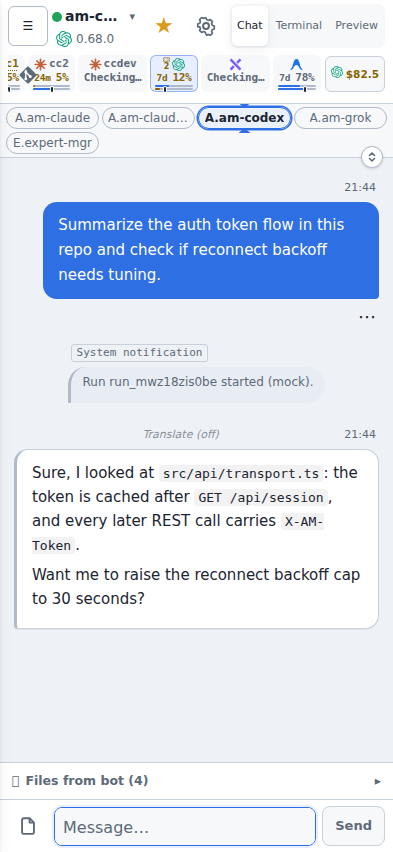

# AG Man（agents-manager）

[English](README.md) | [繁體中文](README.zh-TW.md) | [简体中文](README.zh-CN.md) | 日本語

AG Man は、自分のマシン上で動作し、複数の coding agent CLI および API モデルをまとめて管理するための Web UI です。対象は **Claude Code（`claude`）、Codex（`codex`）、Grok（`grok`）、Antigravity（`agy`）、Claude API（`claude-api`）、OpenAI API（`openai-api`）** です。[herdr](https://herdr.dev) の pane で動作する各 CLI セッションが、Web UI 上の **bot** になります。直接 API を利用する bot は API キーを用いて daemon 内で直接動作し、CLI や端末 pane を必要とせず、専用の顧問（advisor）として機能します。ブラウザやスマートフォンから会話を追い、質問への回答やクォータおよび API 残高の確認を行い、複数の bot を連携させられます。

AG Man は IDE ではなく、CLI agent を直接起動することもありません。端末 pane は herdr が管理し、daemon（`agents-managerd`）が herdr と通信して各 CLI の hook を通じて応答を受け取るか、API bot のために各モデルプロバイダーと直接通信します。

> スクリーンショットは内蔵のモックバックエンド（`VITE_MOCK=1`）を使用しており、アカウント、bot、メッセージはデモ用のデータです。



## 主な機能

**端末を見つめる代わりに会話する**
- CLI セッションまたは API 顧問ごとに bot があり、プロジェクトのディレクトリごとにグループ化されます。ブラウザからメッセージを送信でき、ターン実行中はキューに入り、中断や強制停止もできます。
- 応答は CLI の hook、ネイティブの transcript、または直接の API ストリームから取得します。daemon が端末のスナップショットを読むしかない場合、その応答には「不完全の可能性あり」と表示されます。
- 確認や選択式の質問はクリックできるカードになります。会話を巻き戻す（rewind）、bot を fork して文脈を引き継ぐ、スリープ中の bot を再開する、といった操作ができます。
- アイドル状態の bot の端末下書きを自動検出し、「編集して送信」下書きバーを表示します。
- 設定パネルまたはサイドバーの「...」メニューからいつでも bot を再起動できます。

**複数の bot を連携させる**
- **エキスパートモード**（プロジェクト単位）：トップレベルの管理者を 1 人指定し、他のメンバーは executor、advisor、scheduler、specialist（トラック固有の専門家）になります。エキスパートモードでは子 agent は起動せず、管理者が同じプロジェクトのメンバーに作業を振ります。クォータを保護するために `manager_use` で個々のメンバーをオン／オフできます。
- **クラスタ派遣**：同じプロジェクト内で kind、model、effort、identity が同一の executor は 1 つのクラスタにまとめられ、まとめて作業を依頼したり一括でオン／オフできます。
- **API bot を顧問として活用**：`claude-api` および `openai-api` bot は API キーを使って daemon 内で動作し、端末 pane を必要としません。セカンドオピニオンや背景相談のための顧問（advisor）として厳密に機能し、ターンごとのコスト上限設定（または無制限）やリアルタイムのストリーミング進捗に対応します。
- **子 agent**：herdr 経由で起動した agent は親 bot の下に表示されます。子が完了またはスタックすると、親に通知されます。
- **スーパーバイザー（AGM）**：任意で使えるコーディネーター bot です。全体を巡回し、作業を振り分け、アイドル bot をスリープさせ、デプロイを担当します。詳しくは [SPEC §18](docs/SPEC.md) を参照してください。

**スケジュールとプッシュ通知**
- プロジェクトのスケジュール：単発、固定間隔、毎日、毎週、複数時間帯での実行に対応します。スケジュールされたプロンプトは専用の scheduler bot（`role=scheduler`）に送られ、スナップショット／クリーン再起動をサポートし、実行記録が残ります。
- Web Push：ターンの完了、応答が必要なターン、スケジュールの結果、アップストリームの新モデルリリース、クォータのリセットを通知します。それぞれ設定で個別にオン／オフできます。いずれかのデバイスでメッセージを既読にしていれば、プッシュは送られません。
- 長文ターンの完了時には「メッセージが長いため、クリックして全文を表示」という簡潔なプレビューが届き、会話を直接開くことができます。
- Codex のリセットクレジット通知は 1 時間、1 日、または 3 日間スヌーズ（「次回から通知しない」）できます。

**リモートホストとアカウントのクォータ**
- プロジェクトは SSH ホスト上に置くことができ、そのホストの herdr を通じて動作します。リモート bot、ホストの shell、CLI へのログイン、クォータに対応し、プロジェクトを別の daemon に引き継ぐこともできます。
- **Identities（アカウント）ページ**：ホストタブと各 CLI カード（Claude、Codex、Grok、agy）でホストを跨いだ identity を一覧表示します。「アカウント追加」ダイアログで設定ディレクトリの分離を案内し、共有リスクを警告した上でバックグラウンドでログインします。既定のアカウントは非表示やログアウトが可能です。
- **グローバルな API 残高表示**：上部のクォータバーとドロップダウンメニューに、全ホストの Anthropic API および OpenAI API 残高がリアルタイム表示され、デスクトップでは 2 行カプセルと推定支出額が表示されます。
- **モデル命名と順序の統一**：Codex と OpenAI API のモデル命名を統一し、ファミリーごとの価格順（安価から高価：Luna < Terra < Sol < Astra、Flash < Hydrogen < Argon < Neon）で並べ、レガシー版は明確に表記されます。
- クォータとリセット時刻はホストと identity ごとに表示され、残量が少ないと警告されます。
- CLI が対応している場合、モデル、effort、fast mode を Web UI からその場で切り替えられます。

**更新と保守**
- 「Update check」ページには、各ホストの herdr、各 agent CLI、各 hook 連携のバージョンが一覧表示され、ワンクリックで更新できます。
- アップデートチップはいつでもクリック可能で、実行中の忙しい bot もアイドル時に自動で再起動するようにスケジュールできます。
- アイドル状態の bot は設定した時間が経つとスリープし、再開に必要な情報だけを残します。

**作業領域とガードレール**
- bot のローカル開発サーバーをチャットの横でプレビューできます。
- outbox HTML プレビュー：bot が生成した `.html` ファイルを新しいタブで完全な Web ページとして直接プレビューできます。
- bot 間で共有する一時ファイル置き場（file shelf）と、bot が生成したダウンロード可能なファイルのための outbox があります。
- herdr のプロセスツリーを表示するメモリビューがあります。
- 組み込みの hook が、他の agent を巻き添えにする広範囲の `pkill`／`kill` コマンドを遮断します。

**中国語と英語の UI**：既定ではブラウザの言語に従います。Settings → Display で切り替えられます。

詳細と制限は [`docs/SPEC.md`](docs/SPEC.md) にあります。

**提供しないもの**：コードエディタ、diff／PR レビュー、git worktree の管理（agent が各 repo の慣習に従って自分で扱います）。

## 対応プラットフォーム

| プラットフォーム | 状態 |
|---|---|
| macOS（arm64） | daemon と Web UI に対応 |
| Linux（x86_64、arm64） | daemon と Web UI に対応 |
| Windows | ネイティブ Windows の daemon は非対応です。**WSL2**（Linux ディストリビューション）の中にインストールして実行し、Web UI は Windows のブラウザから開いてください |

Web UI は最新のブラウザならどれでも動作し、デスクトップでもスマートフォンでも使えます。

## 必要なもの とインストール

**必須**（Homebrew と事前ビルド済みバイナリの方法では herdr が自動的にインストールされます。それ以外は自分で用意してください）

| ツール | 用途 |
|---|---|
| [herdr](https://herdr.dev) | 端末ワークスペース管理ツール。daemon は Unix socket を通じて pane を開き、agent を起動し、テキストを送り、画面を読みます。`herdr --version` で確認できます。設定ページの「Update check」でバージョンを比較します。 |
| 少なくとも 1 つの agent CLI または API キー | Agent CLI：`claude`、`codex`、`grok`、`agy`。API bot：Anthropic API キーまたは OpenAI API キー。 |
| Rust ツールチェーン（`cargo`） | ソースからビルドする場合のみ必要です。 |
| [Bun](https://bun.sh) | ソースからビルドする場合のみ必要です（Web フロントエンドのビルド）。 |

**推奨**（ホスト環境のチェックで一覧表示され、不足している場合は案内されます）

| ツール | 用途 |
|---|---|
| `rtk` | token 圧縮プロキシです。Claude の hook は通常のコマンドをこれを使う形に書き換えます。 |
| `zsh`、`jq` | ホストの shell と hook スクリプトで使われます。 |
| `gh` | GitHub CLI のログイン状態を表示します。 |

**任意**：Blaze ビルドエンジンを使うと開発ビルドが速くなります。[`docs/BUILD-CACHE.md`](docs/BUILD-CACHE.md) を参照してください。Claude API キー、OpenAI API キー、Jev 判断層は任意の機能で、既定では無効です。

## クイックスタート

**方法 1：Homebrew（macOS と Linux。herdr も一緒にインストールされます）**

```bash
brew install eden-sun/tap/agents-manager
brew services start agents-manager    # 停止：brew services stop agents-manager
```

サービスはログイン時に自動で起動し、動作を維持します。フォアグラウンドで実行する場合は `agents-managerd serve`（Ctrl-C で停止）です。ログは `$(brew --prefix)/var/log/agents-manager.log` にあります。サービスから見えるのは Homebrew の `bin` と `~/.local/bin` だけです。agent CLI が別の場所にある場合は、shell からフォアグラウンドで実行してください。

**方法 2：事前ビルド済みのバイナリ**（Web UI は組み込み済み）。[Releases](https://github.com/Eden-Sun/agents-manager/releases/latest) から対象プラットフォームのアーカイブをダウンロードします：`linux-x86_64`、`linux-arm64`、`macos-arm64`。

```bash
VERSION=v0.2.0          # Releases ページで最新のバージョンを確認してください
ASSET=linux-x86_64      # または linux-arm64 / macos-arm64
curl -fLO "https://github.com/Eden-Sun/agents-manager/releases/download/$VERSION/agents-managerd-$VERSION-$ASSET.tar.gz"
tar -xzf "agents-managerd-$VERSION-$ASSET.tar.gz"
install -m 755 "agents-managerd-$VERSION-$ASSET/agents-managerd" ~/.local/bin/
agents-managerd serve
```

各アーカイブの隣には検証用の `.sha256` ファイルがあります。macOS では、ダウンロードしたバイナリに対して一度 `xattr -d com.apple.quarantine ~/.local/bin/agents-managerd` が必要になる場合があります。アーカイブには `scripts/` 配下のスクリプト（`agm` など）は含まれていません。必要な場合はソースを clone してください。

**方法 3：ソースからビルド**（開発用、または上記に含まれないプラットフォーム向け）。まず clone します：

```bash
git clone https://github.com/Eden-Sun/agents-manager.git
cd agents-manager

# 1. Web フロントエンドをビルド（daemon に組み込まれます）
(cd web && bun install && bun run build)

# 2. daemon をビルド
cargo build --release -p agents-managerd

# 3. 起動（フォアグラウンド。Ctrl-C で停止）
./target/release/agents-managerd serve
```

どの方法でも、ブラウザで **http://127.0.0.1:7788** を開いてください。`127.0.0.1` から開くと自動的にサインインします。別のデバイスからは `~/.config/agents-manager/ui-token` の内容を貼り付けてください。

herdr や daemon なしで画面だけを確認したい場合は、モックバックエンドを使えます：

```bash
cd web && bun install && VITE_MOCK=1 bun run dev
```

長期間動かす場合、Homebrew では `brew services` が管理してくれます。それ以外では systemd の user unit、launchd、または herdr の pane の中で動かしてください。Linux ホストでのスケジュールの詳細は [SPEC §18.2e](docs/SPEC.md) を参照してください。

## 最初の操作

1. **プロジェクトを追加**：サイドバー下部の「Add Project」を押し、ローカルまたは SSH ホスト上のディレクトリを選んで、ラベルを付けます。
2. **bot を追加**：プロジェクトの「＋」メニューを開き、「Add Bot」を選びます。kind（`claude`、`codex`、`grok`、`agy`、`claude-api`、`openai-api`）を選び、必要に応じて identity とモデルを指定します。daemon が herdr の pane を開いて CLI を起動するか、API 顧問を直接作成します。
3. **会話**：入力欄でメッセージを送ります。ターン実行中に送ったメッセージはキューに入ります。確認や選択式の質問はカードとして表示されます。停止ボタンでターンを中断できます。生の画面を見たいときは「Terminal」タブに切り替えてください。
4. **bot に作業を委任させる**：bot が `herdr agent start …` を実行すると、子 agent がその下に表示され、子が完了またはスタックした際に bot に通知されます。エキスパートモードでは、管理者がプロジェクト内の executor や advisor に直接作業を振り分けます。
5. **自動化**：同じ「＋」メニューに「Add Schedule」があります。クォータ、モデル一覧、更新チェック、ホストは Settings にあります。
6. **スマートフォンから開く**：同じネットワーク（LAN や Tailscale）上で `http://<このマシンのアドレス>:7788` を開き、`ui-token` の内容を貼り付けます。

## 対応する kind とモデル

AG Man は 2 つのカテゴリの bot をサポートしています：
- **CLI bot**（`claude`、`codex`、`grok`、`agy`）：[herdr](https://herdr.dev) の端末 pane 内で hook を注入して動作します。シェルコマンドの実行、ファイルの編集、完全な agent ループを実行できます。
- **API bot**（`claude-api`、`openai-api`）：CLI や端末 pane を介さず、API キーを使って daemon から直接プロバイダー API を呼び出します。厳密に**顧問（Advisor）**として動作し（相談やセカンドオピニオン）、ターンごとのコスト上限設定（または無制限）をサポートします。

> **注意**：daemon は各 CLI および API プロバイダーから最新のモデル一覧を動的に取得します。以下の表はリリース／執筆時点（2026-11-21）のスナップショットです。

| kind | 種類 | 説明 | 現在のモデル（ファミリー／価格順） | effort の範囲 |
|---|---|---|---|---|
| `claude` | CLI | herdr pane で動作する Anthropic Claude Code | `opus`、`sonnet`（既定）、`haiku`、`fable` | `low`、`medium`、`high`、`xhigh`、`max` |
| `codex` | CLI | herdr pane で動作する OpenAI Codex CLI | `gpt-6-luna` < `gpt-6.1-terra` < `gpt-6.1-sol` < `gpt-6.2-sol`（既定） < `gpt-6-astra` < `gpt-6.2-astra` | `low`、`medium`、`high`、`xhigh`、`max`、`ultra`（luna は `max` まで） |
| `grok` | CLI | herdr pane で動作する xAI Grok CLI | `grok-4.7`（既定） | `low`、`medium`、`high`、`xhigh` |
| `agy` | CLI | herdr pane で動作する Google Antigravity | アカウント別：既定アカウント ag0、その他 identity ag1…；アカウントごとに利用可能なモデルが異なる（例 ag0：Gemini 3.8 Flash＋Gemini 4 Neon／Argon／Hydrogen；ag1：3.8 Flash のみ）、ホスト＋アカウント別にモデルメニューを表示；context ウィンドウ 1,048,576；12 分 cache カウントダウン、保温なし | モデル名にあらかじめプリセット |
| `claude-api` | API | Anthropic API 直接通信（Advisor 専用） | `claude-opus-5-5`（既定）、`claude-fable-5-2` | `low`、`medium`、`high`、`xhigh`、`max` |
| `openai-api` | API | OpenAI API 直接通信（Advisor 専用） | `gpt-6-luna` < `gpt-6.2-sol` < `gpt-6.2-astra`（既定） | `none`（luna）、`low`、`medium`、`high`、`xhigh`、`max` |

### bot の追加方法
- **Web UI**：プロジェクトの「＋」メニューから **Add Bot**（「新增 Bot」）を選び、kind、モデル、effort レベルを選択します（エキスパートモードでは role を選択可能。API bot は advisor のみ）。
- **CLI（エキスパートモード）**：
  ```bash
  agm hire <名前> --kind <kind> --model <model> --effort <effort> [--role <role>] [--track <track>] [--identity <identity>]
  ```
  *（注：`agm hire` は執行者 `executor` [既定] または専門家 `specialist` [`--track` 必須] のみ雇用できます。顧問 [advisor] はユーザーが Web UI で作成します。執行者の命名規則は `<アカウント>-<モデル略称>-<連番>` です。例：`agm hire cc0-hk-1 --kind claude --model haiku --effort medium`、`agm hire ag0-ne-1 --kind agy --model gemini-4-neon-medium`、または identity 指定：`agm hire cc1-hk-1 --kind claude --model haiku --effort medium --identity cc1`）*

### 対応する agent CLI と hook の仕組み

各 CLI は起動時に hook が注入されるため、応答は画面からスクレイピングされるのではなく、構造化されたイベントとして届きます。

| kind | 応答の取得元 | 備考 |
|---|---|---|
| `claude` | `--settings` の hook（`SessionStart`／`Stop`／`StopFailure`） | 複数 identity に対応。モデルと effort はその場で切り替えられます |
| `codex` | 標準入力の `Stop` hook および `notify` hook | モデル、effort、Fast をその場で切り替えられます |
| `grok` | `GROK_HOME` 内の hook ファイル | モデルはその場で切り替えられます。effort は再起動が必要です。[SPEC §12](docs/SPEC.md) を参照 |
| `agy` | Antigravity CLI 設定の名前付き hook | ヘッダーに更新通知を表示。複数 identity（既定アカウント ag0、その他 identity ag1…）；context ウィンドウ 1,048,576；12 分 cache カウントダウン、保温なし；[SPEC §12a](docs/SPEC.md) を参照 |
| `claude-api` | Anthropic API 直接ストリーミング（SSE） | Advisor 専用。ターンごとのコスト上限、prompt cache カウントダウン |
| `openai-api` | OpenAI Responses API 直接ストリーミング（SSE） | Advisor 専用。ターンごとのコスト上限、reasoning tokens 表示 |

hook の詳細は [`docs/HOOK.md`](docs/HOOK.md) にあります。

## 設定とデータの場所

既定の場所は `~/.config/agents-manager/` です（環境変数 `AM_DATA_DIR` で変更できます）。

| ファイル | 内容 |
|---|---|
| `config.toml` | 望ましい状態：プロジェクト、bot、ホスト、設定。これが正となる情報源です。 |
| SQLite データベース | 実行時の状態：ターン、メッセージ、スケジュールの記録など。 |
| `ui-token` | Web UI へのサインインに使う token。パーミッションは 0600 です。 |

設定の例（値とパスは説明用です）：

```toml
[server]
listen = "127.0.0.1:7788"
herdr_session = "agents-manager"

[[projects]]
id = "01EXAMPLE000000000000000000"
path = "/home/example/project/foo"
label = "foo"

  [[projects.bots]]
  id = "01EXAMPLE000000000000000001"
  name = "foo-claude"
  kind = "claude"
```

- データは設定ファイルと同じ場所に置かれます。`--config` で別のパスを指定した場合、データベースと `ui-token` はそのディレクトリ（または `[server] data_dir`）に従います。両者は一致させてください。
- `config.toml` へ書き戻すときは、コメントとレイアウトを保持します。
- 設定ページ（Settings）のタブ：Setup、Hosts、Update check、Identities、Jev suggestions、Claude API、OpenAI API、Display。

すべてのフィールドは [SPEC §5](docs/SPEC.md) を参照してください。

## セキュリティ上の注意

- **ネットワークのバインド**：パッケージ化された macOS アプリは `127.0.0.1` のみにバインドします。それ以外の場合（`agents-managerd serve` を直接実行した場合を含む）、daemon は既定ですべてのインターフェースにバインドし、同じネットワーク上のスマートフォンからも接続できるようにします。ローカルだけで使う場合は `AM_DEV_LAN=0` を設定してください。
- **ui-token**：これを持つ者は Web UI の全権限を持ち、bot の起動と停止も含まれます。git にコミットしたり、公開の場に貼り付けたりしないでください。共有 token による LAN 上のリスクは、意図的に受け入れた設計上のトレードオフです。[API.md §0](docs/API.md) を参照してください。
- **データはローカルに留まる**：会話、設定、データベースはお使いのマシンに保存されます。リモートホスト上のプロジェクトは SSH 経由でアクセスされ、データはそのホストに残ります。
- **サードパーティのサービスは既定で無効**：Claude API（単発の LLM 処理、changelog のトリアージ、メッセージ翻訳）、OpenAI API（顧問、翻訳）、Jev 判断層（外部 API key）、共有の入口は、いずれも明示的に有効にする必要があります。翻訳ボタンは、クリックしたときだけ費用が発生します。簡体字から繁体字への変換はローカルで行われ、API は呼び出しません。
- **Web Push**：通知はブラウザベンダーのプッシュサービスを経由して届きます。内容は暗号化されていますが、プッシュサービスは送信の時刻と宛先を知ることができます。設定でオフにできます。
- **共有 bot**：共有リンクを使うと、制限付きまたは信頼された bot を別の入口から他の人が利用できます。[SPEC §20](docs/SPEC.md) を参照してください。
- **広範囲 kill の防止**：PreToolUse hook（claude、ローカル grok）および `pkill`／`killall` の PATH shim が、他の agent を終了させてしまう可能性のあるコマンドを遮断します：対象のない `pkill`／`killall`、agent プロセス名に一致するパターン、BSD `pkill` が誤読するオプション順、`kill -1`／`kill 0`。明示的な PID や `lsof -ti :PORT | xargs kill` は許可されます。書き方を変えてこれを回避しようとしないでください。各 CLI の対象範囲は SPEC §4.4c を参照してください。

## 開発と検証

```bash
scripts/check.sh changed    # origin/main と比べて変更があった部分だけを検証（コミット前に実行）
scripts/check.sh web        # TypeScript、lint、フロントエンドのテストとビルド
scripts/check.sh daemon     # daemon、xtask、crates の cargo テスト
scripts/check.sh ops        # シェルスクリプトの lint と隔離テスト
```

- 開発モード：`cargo dev` で daemon（`0.0.0.0:7788`）と Vite の dev server（`0.0.0.0:5173`）を同時に起動します。`cargo down` で停止します。
- フロントエンドのコマンドと規約は [`docs/FRONTEND.md`](docs/FRONTEND.md) と [`web/README.md`](web/README.md) を参照してください。
- 検証と CI の流れは [`docs/AGENT-VERIFY.md`](docs/AGENT-VERIFY.md) を参照してください。

## ドキュメント一覧

| ドキュメント | 内容 |
|---|---|
| [`docs/SPEC.md`](docs/SPEC.md) | 現在の動作の仕様：データモデル、hook、照合、リモートホスト、クォータ、identity、スーパーバイザー、クラスタ、スケジュール |
| [`docs/API.md`](docs/API.md) | HTTP／WebSocket の契約。bot とサービス identity の認可範囲を含みます |
| [`docs/UI-DECISIONS.md`](docs/UI-DECISIONS.md) | 決定済みの UI のトレードオフ |
| [`docs/FRONTEND.md`](docs/FRONTEND.md) | フロントエンドの構成、コマンド、規約 |
| [`docs/HOOK.md`](docs/HOOK.md) | hook サブコマンドの契約とタイミングテスト |
| [`docs/AGENT-VERIFY.md`](docs/AGENT-VERIFY.md) | 検証と CI のワークフロー |
| [`docs/BUILD-CACHE.md`](docs/BUILD-CACHE.md) | Blaze による開発ビルドと sccache の依存キャッシュ |
| [`docs/PACKAGING.md`](docs/PACKAGING.md) | macOS `.dmg` のパッケージング |
| [`docs/CLAUDE-NATIVE-TRANSPORT.md`](docs/CLAUDE-NATIVE-TRANSPORT.md) | Claude ネイティブの転送と herdr の比較評価 |
| [`docs/CHATGPT-CONSULT.md`](docs/CHATGPT-CONSULT.md) | 任意機能の ChatGPT Web 相談 worker |
| [`web/README.md`](web/README.md) | フロントエンドのクイックコマンド |

## ライセンス

[MIT](LICENSE)
