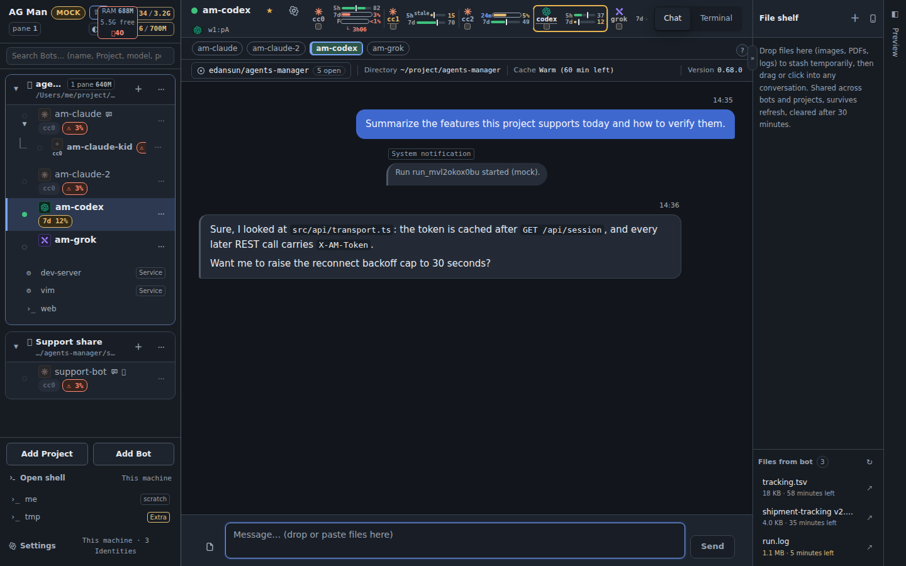
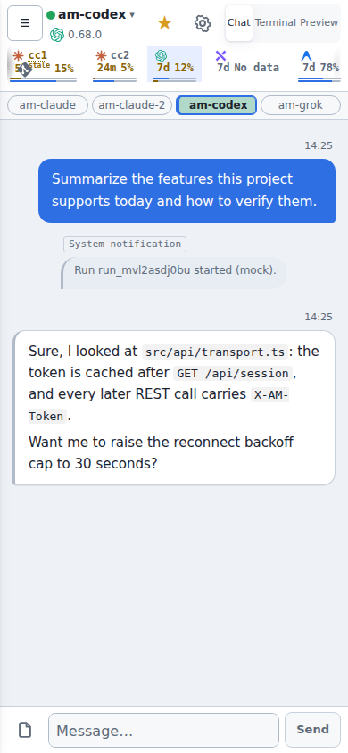
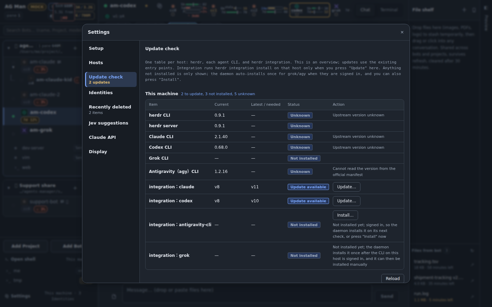
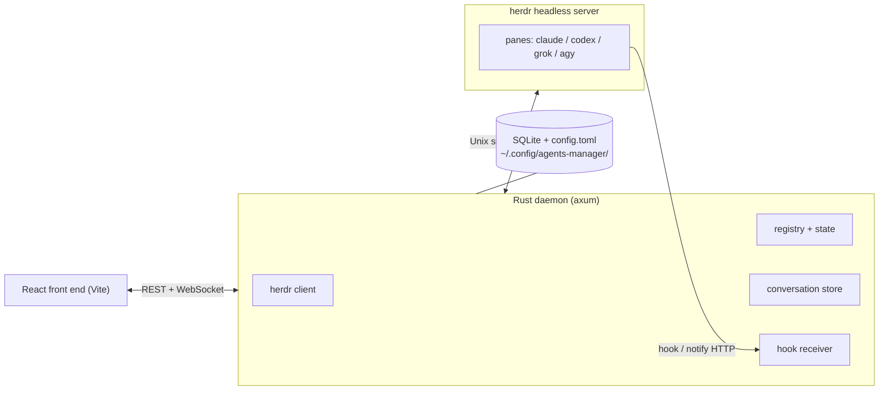

# agents-manager

**English** | [繁體中文](README.zh-TW.md)

Manage coding agents on your local machine and on SSH hosts from one web UI. agents-manager turns every **Claude Code**, **Codex**, **Grok** and **Antigravity (agy)** CLI session running in a [herdr](https://herdr.dev) pane into a "bot", so you can follow conversations, answer prompts, watch quota and coordinate several bots from your desktop or phone. It is not an IDE and it does not spawn agents itself: herdr owns the terminals, the daemon talks to herdr and to the CLIs' hooks.



Screenshots use the built-in mock backend (`VITE_MOCK=1`); accounts, bots and messages are demo data. The UI supports Traditional Chinese and English: it follows the browser language by default, and Settings → Display switches it. The Traditional Chinese screenshots are in [`docs/screenshots/readme/zh-TW/`](docs/screenshots/readme/zh-TW/).

## Key features

**Chat with agents instead of watching terminals**
- One bot per CLI session, grouped by project directory. Send messages from the browser, queue them while a turn runs, interrupt or force-stop.
- Replies come from the CLIs' own hooks or native transcripts. When the daemon has to fall back to a terminal snapshot, the reply is marked as possibly incomplete.
- Confirmations and multiple-choice questions become clickable cards. Rewind a conversation, fork a bot to continue its context, resume a bot that was put to sleep.

**Coordinate many bots**
- `@bot` / `@all` group chat per project.
- Child agents started through herdr appear under their parent bot. The parent is notified when a child finishes or gets stuck.
- Group tasks (missions) with plan / execute / review / verify / deliver cards, driven by the optional AGM supervisor.

**Hosts, accounts and quota**
- Projects on other machines run over SSH against that host's herdr: remote bots, host shells, CLI login, and moving a project to another daemon.
- Claude identities (`cc0`–`cc6`) are discovered from shell aliases, per host, with one-click login and disable.
- Quota and reset times per host and identity, with low-quota warnings, using whatever each provider exposes (Claude, Codex, Grok; agy reports its Gemini bucket only).
- Model, effort and fast mode can be changed live where the CLI supports it.

**Automation**
- Project schedules: one-off, interval, daily and weekly runs queued into an existing bot, with a run ledger.
- Update checks for herdr, agent CLIs and hook integrations on every host, with one-click updates.
- Idle bots are put to sleep after a configurable period, keeping only what is needed to resume them.

**Workspace and guard rails**
- Preview a bot's local dev server next to the chat.
- A cross-bot scratch tray and downloadable bot outputs (outbox).
- A memory view of the herdr process tree, and a hook that blocks broad `pkill`/`kill` commands that would take down other agents.

Details and limits live in [`docs/SPEC.md`](docs/SPEC.md).



## Compared with Orca

[Orca](https://github.com/stablyai/orca) (stablyai) also manages several coding agents at once. The two tools have different centres: Orca is a desktop agent development environment built around git worktrees, terminals, an editor and diff review; agents-manager is a daemon plus web UI built around bot conversations, multi-host state and agent-to-agent delegation. The table compares shapes, not quality. Orca facts come from its README and docs as read on 2026-10-23; Orca ships daily, so check its changelog.

| | agents-manager | Orca |
|---|---|---|
| Shape | Rust daemon + web UI, single binary; herdr runs the CLIs | Electron desktop app with built-in terminals, editor, browser and diff view |
| Platforms | Daemon on macOS and Linux (no Windows daemon); UI in any browser | Desktop app for macOS, Windows and Linux |
| Phone | Same web UI, reachable over LAN or Tailscale; no native app | iOS and Android companion apps paired with the desktop app |
| Agent CLIs | 4 kinds with hook integration: Claude Code, Codex, Grok, Antigravity | Any terminal CLI; 27 preconfigured, including Claude Code, Codex, Grok, Gemini, Cursor, Copilot, OpenCode, Pi |
| Reply capture | CLI hooks and native transcripts, terminal snapshot as a marked fallback; remote hooks via spool files | Terminal view plus agent status hooks (working / waiting / done), notifications and unread state |
| Git worktrees | Not managed by the product; agents create their own per repo conventions | Core feature: one isolated worktree per task, fan one prompt out to several agents, compare and merge |
| Diff / PR review | Not provided (explicit non-goal) | Diff annotations sent back to the agent, GitHub and Linear integration |
| Remote hosts | Whole projects on SSH hosts via that host's herdr; host shells, CLI login, per-host quota; project hand-off between daemons | SSH worktrees with remote terminals, files, git, auto-reconnect and port forwarding |
| Accounts and quota | Claude `cc0`–`cc6` identities per host; quota windows for Claude, Codex, Grok and agy (Gemini bucket) | Account switcher and usage tracking for Claude, Codex, Gemini, Antigravity, OpenCode, Kimi, MiniMax and others |
| Multi-agent work | Child agents tracked under parents with stuck / done notices; `@bot` group chat; mission cards; AGM supervisor | Experimental Orchestration: runs, tasks, dispatches, supervised workers, decision gates, workers on other hosts |
| Idle agents | Supervisor sleeps idle bots (default 90 min, configurable) and keeps resume info | Experimental hibernation (off by default, 30 min) that relaunches the CLI with resume flags |
| Scheduling | One-off / interval / daily / weekly schedules into a bot's queue | Not described in its docs |
| Tooling updates | Version overview and one-click update of herdr, CLIs and hooks per host; upstream changelog triage | Not described in its docs |
| Editor and preview | No editor; embedded preview of a bot's local dev server | VS Code editor, Design Mode, Markdown / PDF / image previews |
| Scripting | HTTP / WebSocket API ([`docs/API.md`](docs/API.md)), `bin/agm` | `orca` CLI (worktree create, snapshot, click, fill) |
| UI language | Traditional Chinese and English (follows the browser, switchable in Settings) | English, with translated READMEs |
| License | MIT | MIT |

Pick Orca when you want an IDE that opens ten worktrees and reviews their diffs. Pick agents-manager when your agents already run in terminals, possibly on other machines, and you want to steer them from a browser, let them delegate to each other, and keep an eye on quota and schedules. They can coexist.

Orca sources: [README](https://github.com/stablyai/orca/blob/d9dc87b2fb08ba52930378941ff470b69d23523d/README.md), [onorca.dev](https://onorca.dev), [worktrees](https://www.onorca.dev/docs/model/worktrees), [SSH](https://www.onorca.dev/docs/ssh), [mobile](https://www.onorca.dev/docs/mobile), [usage tracking](https://www.onorca.dev/docs/agents/usage-tracking), [hooks](https://www.onorca.dev/docs/agents/hooks-memory), [hibernation](https://www.onorca.dev/docs/agents/hibernation), [orchestration](https://www.onorca.dev/docs/cli/orchestration). "Not described" means the public docs did not mention it, not that it is absent.

## Quick start

**Requirements.** macOS (arm64) or Linux (x86_64 / arm64), [herdr](https://herdr.dev), and at least one agent CLI (`claude`, `codex`, `grok` or `agy`) that you have already logged in to. herdr is a terminal workspace manager with a socket API; the daemon uses it to open panes, start agents, send text and read the screen, and never spawns agents itself.

**1. Install with Homebrew** (also installs herdr):

```bash
brew install eden-sun/tap/agents-manager
```

**2. Run the production daemon** as a background service, so it survives logout and restarts with your machine:

```bash
brew services start agents-manager    # stop: brew services stop agents-manager
```

To run it in the foreground instead (Ctrl-C to stop): `agents-managerd serve`. Logs go to `$(brew --prefix)/var/log/agents-manager.log`. The service sees Homebrew's `bin` and `~/.local/bin`; if your agent CLIs live elsewhere, run it in the foreground from your shell.

**3. Open the UI** at http://127.0.0.1:7788. Opening it from `127.0.0.1` signs you in automatically; from another device, paste the token in `~/.config/agents-manager/ui-token`. Then follow [First steps](#first-steps).

**Without Homebrew: prebuilt binary** (the web UI is embedded). Download the archive for your platform from [Releases](https://github.com/Eden-Sun/agents-manager/releases/latest): `linux-x86_64`, `linux-arm64` or `macos-arm64`.

```bash
VERSION=v0.1.0          # pick the latest tag from the Releases page
ASSET=linux-x86_64      # or linux-arm64 / macos-arm64
curl -fLO "https://github.com/Eden-Sun/agents-manager/releases/download/$VERSION/agents-managerd-$VERSION-$ASSET.tar.gz"
tar -xzf "agents-managerd-$VERSION-$ASSET.tar.gz"
install -m 755 "agents-managerd-$VERSION-$ASSET/agents-managerd" ~/.local/bin/
agents-managerd serve   # production daemon with the embedded UI: http://127.0.0.1:7788
```

Each archive has a `.sha256` file next to it. On macOS, a downloaded binary may need `xattr -d com.apple.quarantine ~/.local/bin/agents-managerd` once. To keep the daemon running, start it from launchd, systemd or a herdr pane. Scripts under `scripts/` (such as `agm`) are not in the archive; clone the repo if you need them.

Config and data live in `~/.config/agents-manager/` (override with `AM_DATA_DIR`): `config.toml`, the SQLite database and `ui-token`. Never commit them. The daemon binds every interface so a phone on your LAN or Tailscale can open the same UI; the packaged macOS app binds loopback only (`AM_DEV_LAN=0` / `1` overrides either). Building from source is covered in [Build from source](#build-from-source).

## First steps

1. **Start the daemon**: `brew services start agents-manager` (or `agents-managerd serve` in the foreground), then open http://127.0.0.1:7788. If no herdr server is running, the daemon starts one in the background.
2. **Add a project**: click 「新增 Project」 (Add project) at the bottom of the sidebar, choose a directory on this machine or on an SSH host, and give it a label.
3. **Add a bot**: open the project's `＋` menu and choose 「新增 Bot」 (Add bot). Pick the kind (`claude`, `codex`, `grok` or `agy`) and, optionally, an identity and model. The daemon opens a herdr pane and starts the CLI there with hooks attached.
4. **Chat**: type in the chat box and send. Messages sent during a running turn are queued; a confirmation or multiple-choice question shows up as a card you can click; the stop button interrupts the turn. The terminal tab shows the live pane when you need it.
5. **Let bots delegate**: a bot that runs `herdr agent start …` gets its children listed under it, and it is notified when they finish or get stuck.
6. **Automate**: the same `＋` menu has 「新增排程」 (Add schedule) for one-off, interval, daily or weekly prompts to a bot. Quota, model lists, update checks and hosts live in 環境設定 (Settings).
7. **Use it from your phone**: open `http://<this machine>:7788` over your LAN or Tailscale and paste the token from `~/.config/agents-manager/ui-token`.

## Supported agent CLIs

Each CLI gets a hook injected at launch, so replies arrive as structured events rather than scraped text.

| Kind | Reply source | Notes |
|---|---|---|
| **claude** | `--settings` hooks (`SessionStart` / `Stop`) | Identities `cc0`–`cc6`; live model / effort apply |
| **codex** | `notify` hook per launch | Live model / effort / Fast apply |
| **grok** | hook file in `GROK_HOME` | Model applies live, effort needs a restart; [SPEC §12](docs/SPEC.md) |
| **agy** | named hooks in the Antigravity CLI settings | Update prompt in the header; [SPEC §12a](docs/SPEC.md) |

Hook details are in [`docs/HOOK.md`](docs/HOOK.md).

## Advanced features

These are optional and off until configured.

- **AGM supervisor** — a coordinator bot that patrols the fleet, dispatches work, sleeps idle bots and handles deploys. [SPEC §18](docs/SPEC.md).
- **Jev suggestions** — a judge layer that scores the options of a blocked question and marks them as "Jev suggestion"; it never answers for you. [SPEC §4.3c](docs/SPEC.md).
- **Claude API key** — lets one-off LLM jobs (update triage, changelog translation) skip a full Claude Code session. [SPEC §4.3d](docs/SPEC.md).
- **Share bots** — restricted or trusted bots exposed through a separate share entry point. [SPEC §20](docs/SPEC.md).
- **Update checks** — one settings tab lists herdr, agent CLIs and hook integrations per host. [SPEC §6.9c](docs/SPEC.md).



## How it works



- **web** (`web/`) — React + Zustand, a pure projection of daemon state.
- **daemon** (`daemon/`, binary `agents-managerd`) — reconciles with herdr, injects hooks, matches turns, projects `config.toml` into SQLite, serves HTTP / WebSocket.
- **herdr** — owns the real pane and agent lifecycle, sends prompts, reads the screen.

`config.toml` is the source of truth for desired projects and bots; SQLite holds runtime state (runs, turns, messages).

## Build from source

For development or unsupported platforms. Needs Rust (`cargo`) and [Bun](https://bun.sh) in addition to herdr.


Rust development builds default to [Blaze](https://github.com/indexable-inc/blaze) through `scripts/project-cargo.sh` (Linux x86-64/ARM64 and Apple silicon). Install it once per Linux host (the current nightly lacks memory-budget support, so use the pinned source build):

```bash
scripts/install-blaze.sh --source
AGM_RUST_ENGINE=blaze scripts/project-cargo.sh build -p agents-managerd
scripts/project-cargo.sh test -p xtask
```

Linux and Apple silicon macOS default to Blaze for build/run (`AGM_RUST_ENGINE=blaze`); managed panes route ordinary `cargo build/run` through this entrypoint after a daemon update; `cargo dev` uses it for the daemon build. Missing or unsupported Blaze fails by default. Set `AGM_RUST_ENGINE=cargo` to explicitly use Cargo; `AGM_RUST_ENGINE=auto` explicitly enables fallback when Blaze is unavailable. Release/custom profiles, cross targets, `check`, Clippy, formatting and `scripts/check.sh`/CI use native Cargo. Tests always retain native Cargo and the configured remote worker route (r7); even `AGM_RUST_ENGINE=blaze` does not change this. The shared project daemon uses an 8 GiB soft worker budget and a 600-second idle timeout. A three-worktree daemon build measured 23.33 GiB peak and 20.76 GiB steady background RSS, so the 8 GiB budget must not be treated as a hard limit. Set `AGM_RUST_ENGINE=cargo` to opt out. First builds load the project; only compatible warm edits avoid recompilation/linking. See [build engines and cache](docs/BUILD-CACHE.md) for toolchain, memory and troubleshooting.

**Development mode** (daemon on `0.0.0.0:7788`, Vite dev server on `0.0.0.0:5173`):

```bash
git clone git@github.com:Eden-Sun/agents-manager.git
cd agents-manager
cargo dev     # start both
cargo down    # stop both
```

**Build the release binary yourself.** The UI is embedded in the daemon binary, so build the front end first:

```bash
cd web && bun install && bun run build && cd ..   # produces web/dist
cargo build --release -p agents-managerd
./target/release/agents-managerd serve            # http://127.0.0.1:7788
```

**Front end only, without herdr** against an in-memory fake backend:

```bash
cd web
bun install
VITE_MOCK=1 bun run dev
```

## Documentation and development

| Document | Contents |
|---|---|
| [`docs/SPEC.md`](docs/SPEC.md) | Specification of current behavior: data model, hooks, reconcile, remote hosts, quota, identities, AGM, group tasks |
| [`docs/API.md`](docs/API.md) | HTTP / WebSocket contract, including bot auth scopes |
| [`docs/FRONTEND.md`](docs/FRONTEND.md) | Front-end structure, commands and non-obvious conventions |
| [`docs/UI-DECISIONS.md`](docs/UI-DECISIONS.md) | Settled UI trade-offs |
| [`docs/HOOK.md`](docs/HOOK.md) | Hook subcommand contract and timing tests |
| [`docs/AGENT-VERIFY.md`](docs/AGENT-VERIFY.md) | Verification and CI workflow for contributors and agents |
| [`docs/BUILD-CACHE.md`](docs/BUILD-CACHE.md) | Blaze development builds and sccache dependency cache |
| [`docs/PACKAGING.md`](docs/PACKAGING.md) | Packaging the macOS `.dmg` |
| [`docs/CLAUDE-NATIVE-TRANSPORT.md`](docs/CLAUDE-NATIVE-TRANSPORT.md) | Evaluation of Claude-native messaging versus herdr |
| [`docs/CHATGPT-CONSULT.md`](docs/CHATGPT-CONSULT.md) | Optional ChatGPT web consult worker |
| [`web/README.md`](web/README.md) | Front-end quick commands |

Before pushing, run `scripts/check.sh changed`; see [`docs/AGENT-VERIFY.md`](docs/AGENT-VERIFY.md). Docs describe the current state only; history lives in git.

## License

[MIT](LICENSE)
