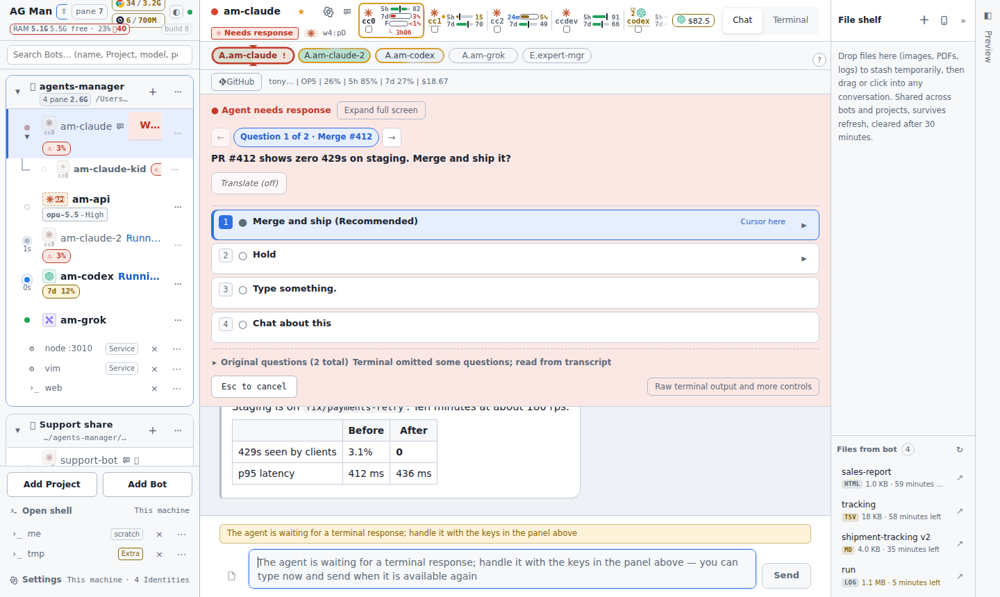
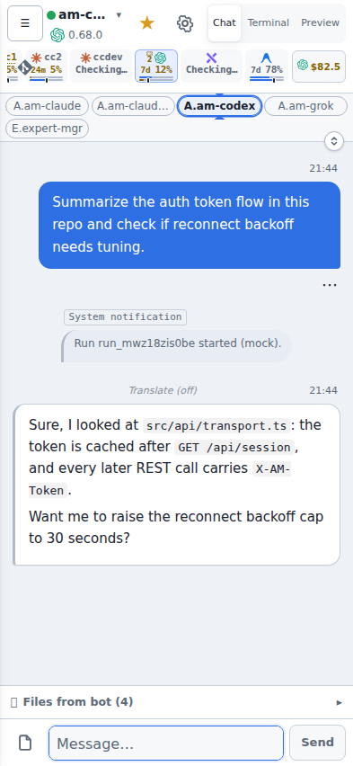

# AG Man (agents-manager)

English | [繁體中文](README.zh-TW.md) | [简体中文](README.zh-CN.md) | [日本語](README.ja.md)

**One web page to run a whole team of coding agents — Claude Code, Codex, Grok, Antigravity, and API advisors — on your own machines, from your desk, iPad, or phone.**

Running several coding-agent CLIs usually means juggling terminal tabs, missing the one that has been waiting on a yes/no prompt for an hour, and guessing how much quota is left. AG Man puts every agent session into one self-hosted web UI, alerts you when one needs input, and lets bots coordinate with each other.

<table>
  <tr>
    <td width="76%"></td>
    <td width="24%"></td>
  </tr>
</table>

> Screenshots use the built-in mock backend (`VITE_MOCK=1`); accounts, bots, and messages are demo data.

## How it works

AG Man is a lightweight local daemon (`agents-managerd`) with an embedded web UI. CLI agents run inside [herdr](https://herdr.dev) (a tmux-like terminal workspace manager); the daemon launches them, delivers your prompts, and receives replies through each CLI's native hooks — so you get clean structured messages and clickable approval cards instead of scraped terminal text. API advisors run directly inside the daemon with your API keys and need no terminal at all. Everything stays on your machines.

AG Man is not an IDE: there is no code editor, diff viewer, or git worktree manager. Your agents handle those using each repository's own conventions.

## Supported agents

| Kind | What it is |
|---|---|
| `claude` | Anthropic Claude Code CLI |
| `codex` | OpenAI Codex CLI |
| `grok` | xAI Grok CLI |
| `agy` | Google Antigravity CLI |
| `claude-api` | Anthropic API directly (no CLI; advisor role) |
| `openai-api` | OpenAI API directly (no CLI; advisor role) |

CLI bots run commands and edit files. API bots answer questions and give second opinions with an optional per-turn cost ceiling. Available models and effort levels are read live from each CLI or provider and can be switched from the web UI where supported. Multiple accounts per CLI are supported.

## Features

**Talk to agents, not terminals**
- Every CLI session becomes a chat grouped by project, with clear status (working, done, or waiting on you).
- Queue follow-up messages while a turn is running; confirmations and multiple-choice questions turn into clickable cards.
- Interrupt, rewind, fork a bot to continue its context, or switch to the raw terminal tab anytime.

**Stay in the loop from anywhere**
- Responsive UI for desktop, iPad (portrait/landscape, with Apple Pencil hover preview), and phones over LAN or Tailscale.
- Web Push notifications for finished turns, prompts waiting on you, schedule results, and quota resets — automatically silenced when you are already looking.

**Let bots work as a team**
- **Team roles (Expert mode)**: put a manager bot in charge of a project to dispatch tasks to workers and consult advisors.
- **Clusters**: group identical workers so tasks automatically go to whichever one is free.
- **Child agents & supervisor**: child agents spawned via herdr appear nested under their parent with completion alerts; an optional supervisor bot patrols the fleet and sleeps idle bots.

**Accounts, quota, and remote hosts**
- Live subscription quota, reset timers, and Anthropic / OpenAI API balances in one top strip across every account and host.
- Add and log in to isolated accounts from the Identities page, and sync identities across connected hosts.
- Run projects on remote SSH hosts with the same bots, shells, logins, and quota views.

**Automate and keep machines healthy**
- Project schedules (one-off, interval, daily, weekly, multi-slot) with a run history.
- One-click updates for herdr, each agent CLI, and their hooks on every host.
- Idle bots sleep automatically and resume with context; host memory and CPU usage are always visible in the sidebar.
- A built-in guard blocks broad `pkill`/`killall` commands that could take down other agents.

**Workspace extras**
- Side-by-side dev server preview next to the chat, with phone and iPad viewport presets.
- Cross-bot **File shelf** and per-bot **Outbox** with one-click HTML page preview and inline generated images.
- **Share links** to expose a restricted or trusted bot to teammates through a separate entry point.

English and Chinese UI included (switches in Settings → Display). Full behavior and limits are in [`docs/SPEC.md`](docs/SPEC.md).

## Platforms and requirements

- **macOS (arm64)** and **Linux (x86_64, arm64)**. On Windows, run inside **WSL2** and open the UI from a Windows browser.
- **[herdr](https://herdr.dev)** — installed automatically by Homebrew; for prebuilt binaries or source builds, install `herdr` from [herdr.dev](https://herdr.dev) first.
- **At least one agent CLI or API key** from the table above.
- Building from source also requires a Rust toolchain (`cargo`) and [Bun](https://bun.sh).

The Settings page checks each host and suggests optional helpers (`rtk`, `zsh`, `jq`, `gh`) if missing.

## Quick start

> **Try the UI first without installing the daemon or herdr:**
> ```bash
> git clone https://github.com/Eden-Sun/agents-manager.git
> cd agents-manager/web && bun install && VITE_MOCK=1 bun run dev
> ```

**Option 1: Homebrew** (macOS and Linux — installs `herdr` automatically)

```bash
brew install eden-sun/tap/agents-manager
brew services start agents-manager    # stop: brew services stop agents-manager
```

The service starts at login. It only sees Homebrew's `bin` and `~/.local/bin`; if your agent CLIs live elsewhere, run `agents-managerd serve` from your shell instead.

**Option 2: Prebuilt binary** (web UI embedded; the release archive contains only `agents-managerd`, not `herdr` — install [herdr](https://herdr.dev) first and make sure it is in `PATH`). Download the latest archive from [Releases](https://github.com/Eden-Sun/agents-manager/releases/latest):

```bash
VERSION=v0.2.0          # replace with the latest tag on Releases
ASSET=linux-x86_64      # or linux-arm64 / macos-arm64
curl -fLO "https://github.com/Eden-Sun/agents-manager/releases/download/$VERSION/agents-managerd-$VERSION-$ASSET.tar.gz"
tar -xzf "agents-managerd-$VERSION-$ASSET.tar.gz"
install -m 755 "agents-managerd-$VERSION-$ASSET/agents-managerd" ~/.local/bin/
agents-managerd serve   # make sure ~/.local/bin is in your PATH
```

On macOS, a downloaded binary may need `xattr -d com.apple.quarantine ~/.local/bin/agents-managerd` once.

**Option 3: Build from source** (requires `herdr`, Rust, and Bun)

```bash
git clone https://github.com/Eden-Sun/agents-manager.git
cd agents-manager
(cd web && bun install && bun run build)        # embeds the web UI into the daemon
cargo build --release -p agents-managerd
./target/release/agents-managerd serve
```

Then open **http://127.0.0.1:7788** (auto-signed-in locally; on a phone or other device, open `http://<host-ip>:7788` and paste `~/.config/agents-manager/ui-token`). Click **Add Project**, then **Add Bot**, and start chatting.

## Data and security

- Settings and history live in `~/.config/agents-manager/` (override with `AM_DATA_DIR`). Remote projects keep their data on their own host.
- `ui-token` in that directory grants full control of the UI — keep it private.
- `agents-managerd serve` listens on all interfaces so phones on your LAN/Tailscale can connect; set `AM_DEV_LAN=0` to keep it local only. The packaged macOS app listens on `127.0.0.1` only.
- Paid third-party features (Claude API, OpenAI API, message translation, sharing) are off until you turn them on.
- Web Push goes through your browser vendor's push service (payloads are encrypted, but delivery metadata is visible to the push service).

## Development

```bash
scripts/check.sh changed    # verify what changed relative to origin/main
cargo dev                   # daemon on :7788 + Vite dev server on :5173 (cargo down to stop)
```

See [`docs/FRONTEND.md`](docs/FRONTEND.md), [`docs/AGENT-VERIFY.md`](docs/AGENT-VERIFY.md), and [`docs/BUILD-CACHE.md`](docs/BUILD-CACHE.md).

## Documentation

| Document | Contents |
|---|---|
| [`docs/SPEC.md`](docs/SPEC.md) | Full behavior specification: bots, hooks, hosts, quota, identities, expert mode, schedules |
| [`docs/API.md`](docs/API.md) | HTTP / WebSocket API |
| [`docs/HOOK.md`](docs/HOOK.md) | How each CLI's hooks report replies |
| [`docs/UI-DECISIONS.md`](docs/UI-DECISIONS.md) | Settled interface trade-offs |
| [`docs/PACKAGING.md`](docs/PACKAGING.md) | Building the macOS `.dmg` |

## License

[MIT](LICENSE)
