# agents-manager

**English** | [繁體中文](README.zh-TW.md)

A local multi-agent manager. Its web UI presents every coding-agent CLI (**claude** / **codex** / **grok**) running in a [herdr](https://herdr.dev) pane as a "bot", groups bots by directory, and lets you send messages, read replies and answer blocked prompts from a chat window.

With several agents open in terminals at once, output gets crowded, status is hard to read, and there is no timeline across bots. This project does not manage the agent processes themselves — that is herdr's job. It organizes them into Project / Bot / Run / Turn, collects replies reported by hooks into conversations, and lets you drive everything from the browser.

## Architecture

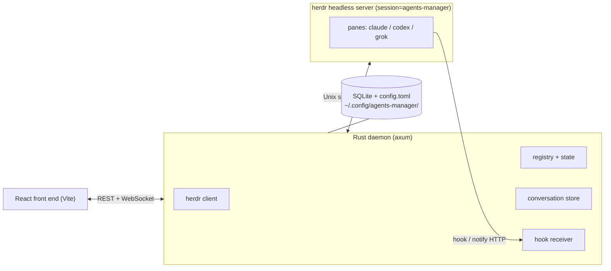

Division of labor:

| Layer | Does | Does not |
|---|---|---|
| **web** (`web/`) | Sidebar, conversations, groups, group tasks, settings, quota bars | Touch agent processes directly |
| **daemon** (`daemon/`, binary `agents-managerd`) | Reconciles with herdr, injects hooks, matches Turns, projects TOML→SQLite, serves HTTP / WS | `spawn` claude / codex / grok |
| **herdr** | Owns the real pane / agent lifecycle, sends prompts, reads the screen | Know about Bots / Turns / groups |

The config file `~/.config/agents-manager/config.toml` is the source of truth for the **desired** Project / Bot settings; SQLite holds runtime state such as Runs / Turns / Messages. The daemon projects the TOML on startup and after every write-back.

## Screenshots

Higher-numbered file names are usually newer. The images below show the current UI, not an early demo.

**Main chat view** — The sidebar lists bots per project with status lights; the right side shows the selected bot's bubbles, live output, the queued next message and quota bars. Each bubble is labeled with its reply source (`hook` or `terminal_fallback`). The sidebar's top-left reads `AG Man ｜ pane N ｜ RAM used · free/total`: how many herdr panes are open, how much memory the herdr process tree uses, and how much the whole machine has left.

The header's first line is the name, ★ and ⚙; the second line is **kind icon · model · pane id**. Each kind has a brand color (claude orange, codex OpenAI green, grok purple) and the model chip uses the same color; codex model names drop the redundant `gpt-` prefix (`6-astra`, full id in the tooltip). The row under the header is the **★ pinned row**: pinned bots stay in front, followed by recently finished and in-progress ones.

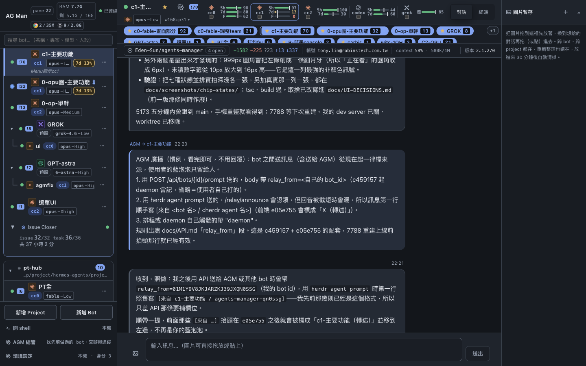

**You can tell who said what** — Blue right-aligned bubbles belong **only to the user**. Every other source is left-aligned with a panel background and a left bar, labeled above:

- `AGM → x`: rulings / assignments the supervisor sent through the daemon (`messages.relay_from` records AGM's bot id).
- `x (relayed)`: no `relay_from`, but the first line has an `AGM …:`, `[AGM …]` or `[來自 <bot> / <agent>]` header — supervisor messages the user pasted by hand, or bot-to-bot `herdr agent prompt` messages the daemon did not claim.
- `daemon auto-trigger`: notifications from scheduled scripts and the daemon itself (`relay_from = "daemon"`); `[AG Man 通知]` gets an extra yellow bar.

Bot-to-bot messaging convention: requests to `POST /api/bots/{id}/prompt` must send `X-AM-Bot-Id: $AM_BOT_ID` and `X-AM-Bot-Token: $AM_BOT_TOKEN`; `relay_from` may be omitted (the daemon uses the authenticated bot id), and if present it may only be the sender's own id — it cannot be used to impersonate another bot. User requests without Bot headers that authenticate with the shared UI token still have the #339 / #410 unverified compatibility window and are labeled "unverified"; `relay_from=daemon` from the API returns 403; `relay_from` pointing at the receiving bot itself returns 400 `relay_self`. Missing Bot headers, a wrong token, or mixing in the UI token are rejected rather than downgraded to User. Messages sent with `herdr agent prompt` are claimed by the PATH shim through `/relay/announce`, which also writes a `[來自 …]` header on the first line as a fallback. See the prompt section of [`docs/API.md`](docs/API.md).

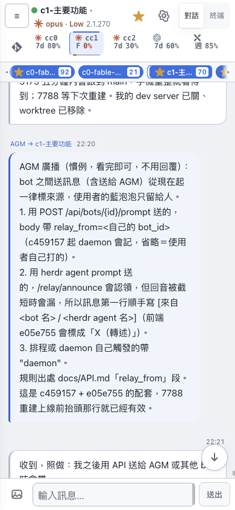

**Prompts that need you are never hidden** — When an agent stops at a y/n or menu prompt (`blocked`):

- A red **`● 需要回應`** ("needs response") stays at the front of the header's second line, whether you are on the chat, terminal or shell tab; click it to open the full-screen terminal. It disappears once resolved.
- That bot's chip in the ★ pinned row turns into a red frame with a red dot; a bot **waiting on a child agent** turns yellow instead (red is reserved for "you personally need to act"). The parent row in the sidebar also shows a yellow dot next to its light: solid = child still running, hollow = child reported back and nobody has looked yet.
- claude's numbered menus are rendered as clickable lists, so you do not need to press ↓ to find an option; **multi-page, multi-select questionnaires are read in full first, answered offline and submitted in one go**, with the screen re-read and compared before sending — on any mismatch nothing is sent. Unrecognized screens fall back to the terminal snapshot plus key panel.

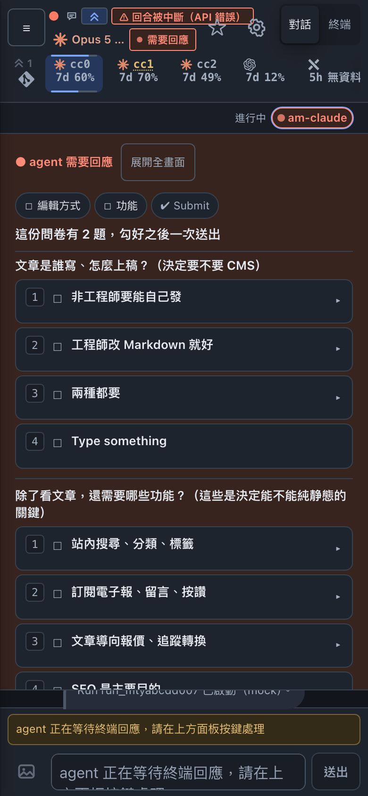

The sidebar can search bots and rename them inline; each row's action buttons (start / stop / settings / delete) are laid out 2×2; the status light is a ring, so "connected" and "running" look different.

Turn state has an extra **done (unread)** stage: once a bot has replied but you have not looked, both the sidebar row and the collapsed project header show an unread badge, cleared when you switch to that conversation (or bring the tab back to the foreground); unread state survives a reload.

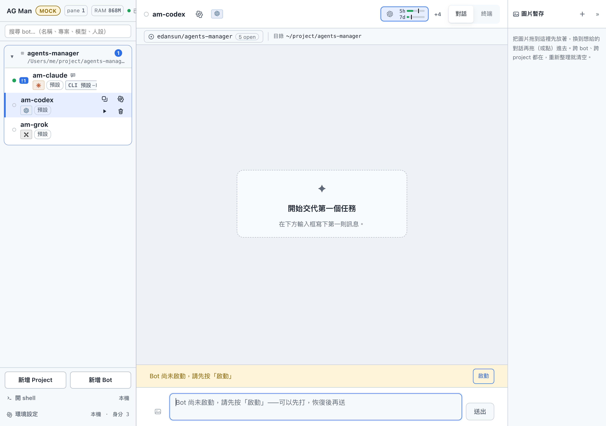

**Turns can be aborted mid-flight** — While a turn runs the input box stays unlocked (you can type ahead and queue), and the bar above it offers two exits: "interrupt reply" asks the agent to stop (sends `esc`); **force abort** does not wait for the agent — it closes the turn and unlocks the input. Use it when `esc` cannot get through (pane gone, herdr disconnected, agent unresponsive), without stopping the whole bot.

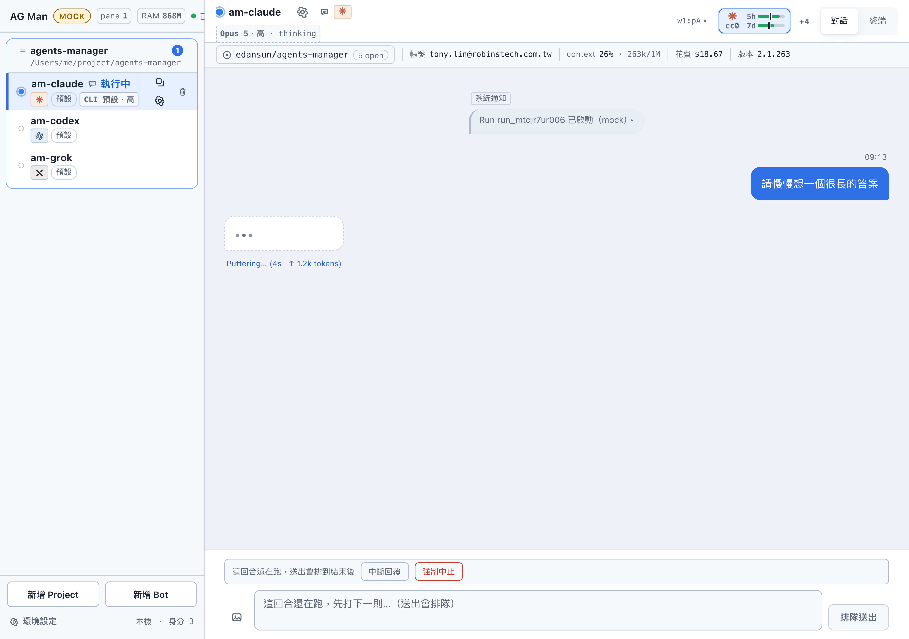

**Group chat** — A Project is a group. `@<bot>` / `@all` fans out to members, each getting its own Turn; the timeline folds one message into a single bubble. Messages without a mention are not sent.

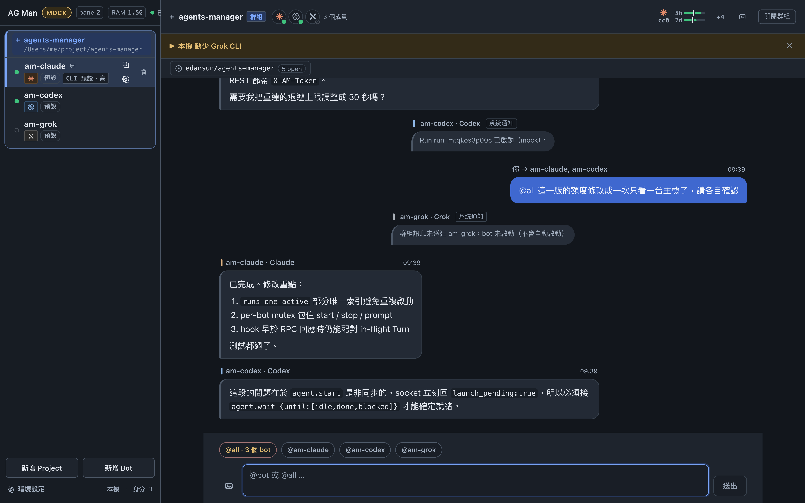

**Bot settings** — The nickname can be changed at any time (no restart). Model / effort depend on kind: claude has `--effort` (low…max, 2.1+), and both model and effort can be applied live via the TUI's `/model` / `/effort`; grok's reasoning effort is per-model (only 4.6 has `xhigh`, 4.5 does not) and changes need a restart (`/effort` writes to `~/.grok/config.toml`); codex always restarts. Identities (`cc0`–`cc6`) apply to claude only.

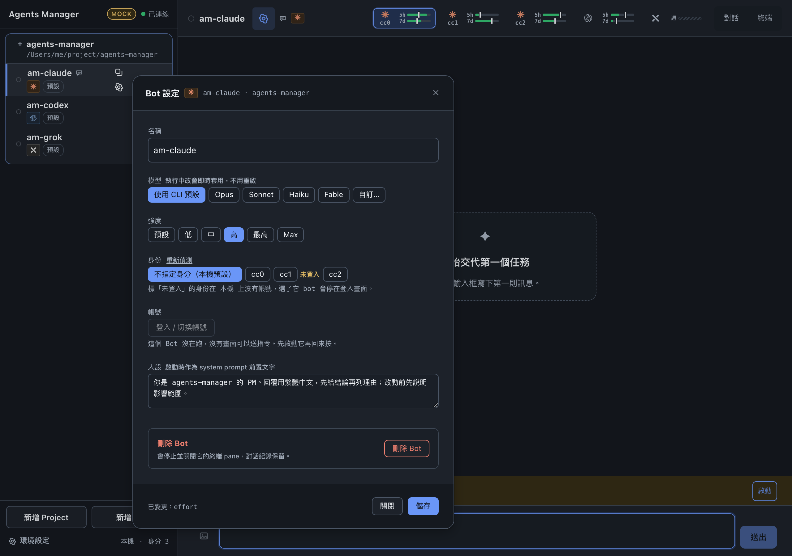

**Quota** — The header always shows 5h / 7d windows for claude / codex / grok (grok has only the weekly window). claude can be split per identity (cc0 / cc1 / …). Numbers appear once remaining quota drops below a threshold; lower still, the sidebar bot row shows a warning. Thresholds are computed by the daemon; the front end only reads `low` / `critical`.

Quota is **per host** ([SPEC §14](docs/SPEC.md)): the bar shows one machine at a time — local by default; selecting a bot or project on an ssh host switches to that host and shows a host badge. Remote numbers are also read by the daemon from that host (codex via ssh RPC; claude / grok via a throwaway pane on that host that asks `/usage`).

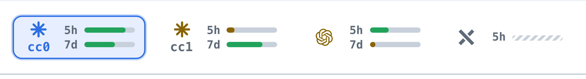
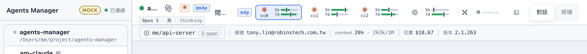

**Identities cc0–cc6** — Multiple accounts need no extra config: the daemon reads `alias ccN='CLAUDE_CONFIG_DIR=… claude …'` from each host's login shell and offers `cc0`–`cc6` as assignable identities ([SPEC §16](docs/SPEC.md)). The same `cc1` can be a different account locally and remotely — it follows that machine's alias. Hand-written `[[identities]]` still work and win on name conflicts.

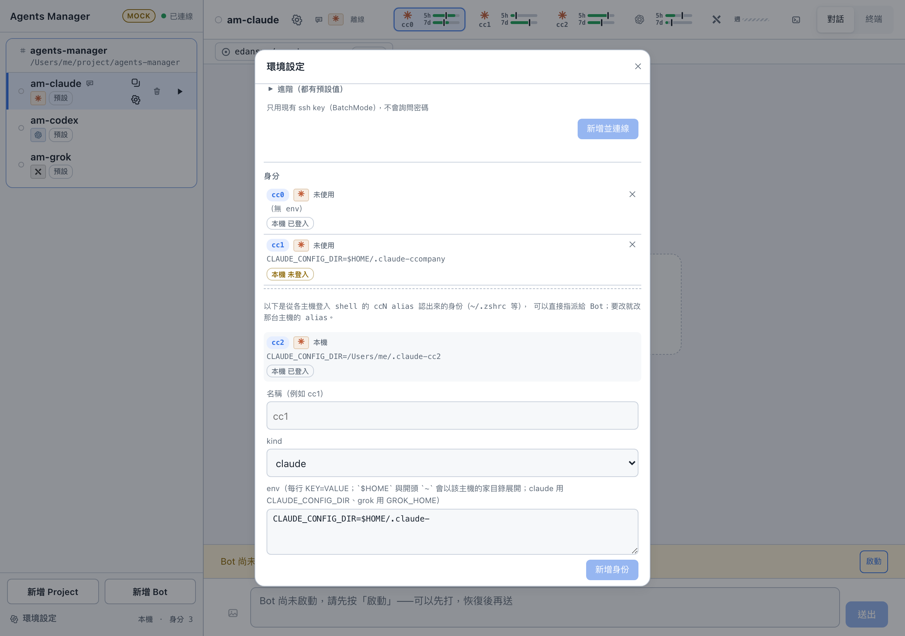

**Child-agent tracking** — When a bot uses herdr inside its pane to start child agents (parallel subtasks, reviewers and so on), AG Man attaches them under the parent bot instead of leaving an orphaned pane. Three mechanisms make this work, independent of agent discipline:

- **Pane lineage**: one bot, one tab. During reconciliation, any agent split inside the tab of a bot's active run is treated as its child; the name prefix is only a cross-tab fallback. Grandchildren attach under children the same way.
- **herdr PATH shim**: every pane the daemon starts has a wrapped `herdr` first on PATH. `agent start <name>` adds a `<parent agent name>-` prefix automatically; `pane split` / `tab create` pass the parent's account (`CLAUDE_CONFIG_DIR` / `CODEX_HOME`) and hook environment down with `--env` — herdr panes are spawned by the server and do not inherit the caller's shell, so without this the child pane would start with the default account and receive no hooks.
- **herdr skill**: before starting a claude bot, the daemon writes `herdr --skill` into that identity's `skills/herdr/SKILL.md` (untouched if identical), prefixed with AG Man rules: reuse idle children first, naming, `pane split --pane "$HERDR_PANE_ID"`, no `git stash`. codex / grok get the same text in their persona.

**Host shell** — Host rows (including remote ones) can open a shell directly: install tools, read logs, clean worktrees, without opening a separate terminal and ssh. It shows a terminal snapshot plus a one-line command input, with Ctrl+C / Esc buttons and ↑↓ history; it can only drive panes the daemon opened itself. Open shells are listed on the host row, where you can return to or end them.

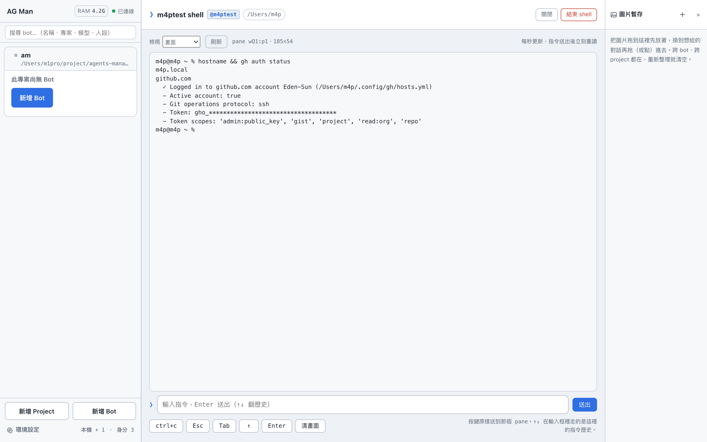

**Remote `gh` login** — The issue list relies on `gh` on that host. When a remote host is not logged in, the host row offers a button and the daemon tries, in order: switch to an already-valid account → drop the invalid active account and switch → forward the local `gh auth token` over ssh stdin (never in argv or logs) → finally fall back to GitHub's device code, with the UI showing the `user_code` and link.

**Image tray** — A persistent tray along the right edge: drop images into it, switch to another bot, then drag or click them into that conversation's attachment tray to send together. It works across bots / projects, lives only in memory, and clears on reload.

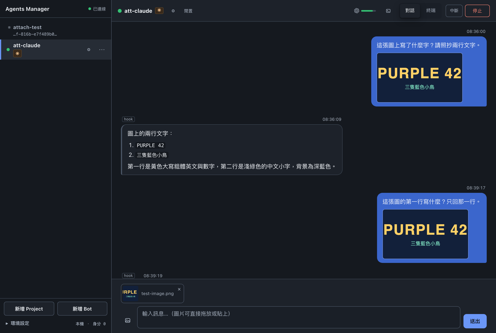

## Installation and startup

[](https://github.com/Eden-Sun/agents-manager/actions/workflows/ci.yml)

Pull requests, a daily schedule and manual dispatch run GitHub Actions (macOS, daemon and web checks); every push to `main` is verified in the background by `scripts/ops/ubuntu-ci.sh` on agm-host against each part's last green baseline, with a full four-part run every 24 hours by default, reported as the `ubuntu-ci` commit status. Before wrapping up development, run `scripts/check.sh changed` (only what changed) or `scripts/check.sh` (no arguments: ob, ops, web and daemon) from the repo root; the `web` / `daemon` arguments run one side only.

Requirements: Rust (`cargo`), [Bun](https://bun.sh), an installed [herdr](https://herdr.dev) (socket protocol 20 and 22; tested on 0.8.2, 0.9.1, 0.9.3), and at least one agent CLI (`claude` / `codex` / `grok`).

```bash
git clone git@github.com:Eden-Sun/agents-manager.git
cd agents-manager

# Start the daemon (0.0.0.0:7788) + Vite dev server (0.0.0.0:5173) together
cargo dev
# ...
cargo down    # stop both
```

> **On machines with an AGM supervisor, 5173 shows what has already been merged into `origin/main`**: that dev server is maintained by AGM's watchdog (not the one `cargo dev` starts) and runs from a clean worktree that only tracks `origin/main` (`git fetch && git reset --hard origin/main` every minute), so pushed changes show up on reload. Bots verifying **uncommitted** changes should use their own port and leave 5173 alone — it is the user's window ([SPEC §18.1](docs/SPEC.md)). 7788 is the production daemon; front-end changes reach it only after the next release rebuild.

`cargo dev` / `cargo down` are `xtask/` aliases (see `.cargo/config.toml`): after `cargo build --bin agents-managerd` + `bun install`, they start the daemon and `vite --host` as ordinary child processes, record PIDs in `target/dev.pids` and write logs to `target/dev-logs/`.

**Development daemons always bind every network interface** (not just loopback) and fully allow peer addresses and Origins (not just RFC1918 — overlay networks such as Tailscale use 100.64.0.0/10, and a hard-coded allowlist cannot keep up), so phones and other machines on the same LAN or Tailscale can reach `:7788` or `:5173` directly without an SSH tunnel. **Only the packaged macOS app** (`scripts/package-dmg.sh`, executable at `…app/Contents/MacOS/agents-managerd`) binds `127.0.0.1` and accepts local connections only.

The decision is based on "running inside a .app bundle", not an environment variable (the daemon restarts dozens of times a day, and a forgettable environment variable is not a security boundary). Override with `AM_DEV_LAN`: `=0` makes a development build local-only, `=1` opens a packaged build to the network.

You can also run the pieces separately, so 7788 serves the UI itself without a separate Vite:

```bash
# 1. Build the front end first: release daemons enable `embed-ui` by default and embed web/dist at compile time, so order matters
cd web
bun install
bun run build        # → web/dist
cd ..

# 2. daemon (writes ~/.config/agents-manager/ on first start)
cargo build --release -p agents-managerd
./target/release/agents-managerd serve    # http://127.0.0.1:7788
```

- Skipping step 1 still compiles, but that daemon has no UI: opening 7788 returns a one-line "web UI not embedded" 404. If you build the front end afterwards, the daemon must be **recompiled** to embed it (`crates/am-base/build.rs` watches `web/dist`, so a normal `cargo build` re-embeds; see the notes at the top of `crates/am-base/src/assets.rs`).
- The workspace's `desktop/` (Tauri shell) needs a `desktop/binaries/agents-managerd-<triple>` sidecar that only `scripts/package-dmg.sh` puts in place, so it is excluded from the default build: `cargo build` / `cargo test` without `-p` build only `daemon` and `xtask`. To package an app see [`docs/PACKAGING.md`](docs/PACKAGING.md).

To iterate on the front end, run the daemon as above and start the Vite dev server in another terminal (it proxies /api, /hook and /ws to 7788):

```bash
cd web
bun run dev          # http://localhost:5173
```

During development you can also use `cargo run -p agents-managerd -- serve` (debug build). `vite.config.ts` must set `changeOrigin: true`: the daemon requires `Host` to be `127.0.0.1:<port>` / `localhost:<port>`, and an unrewritten Host gets a 403.

No herdr, just want to see the UI:

```bash
cd web
bun install
VITE_MOCK=1 bun run dev
```

Config and data live in `~/.config/agents-manager/` (override with `AM_DATA_DIR`; when `--config` points elsewhere, the data directory follows the config file, and only one daemon may use a directory). `config.toml`, SQLite and `ui-token` are all there — **do not** commit them to git.

## Supported agent kinds and hooks

Replies come primarily from each CLI's hook / notify; the terminal screen is only a fallback. Hook identity is **per bot** (`bot_id` + `hook_token`) and never changes the user's global settings.

| kind | Injection | Reply event |
|---|---|---|
| **claude** | `--settings <daemon-generated json>` on every start, with `SessionStart` / `Stop` pointing at `agents-managerd hook claude` | stdin JSON; `last_assistant_message` |
| **codex** | `-c notify=[agents-managerd, hook, codex, …]` on every start (overrides the user's own notify for this instance) | JSON as the last argv argument; `last-assistant-message` |
| **grok** | **No** per-start hook flag. The daemon writes `<GROK_HOME>/hooks/agents-manager.json` + a fixed dispatch script, which finds the bot via the pane env `AM_BOT_ID` / `AM_HOOK_TOKEN` | stdin JSON, same subcommand as claude |

All three hook subcommands share one contract: wall-clock ≤ 3 seconds, always exit 0, always empty stdout; on failure they spool to the bot's directory and the daemon replays after restart. Details in [`docs/HOOK.md`](docs/HOOK.md) and spec §4 and §12.

With `inject_hooks = false` nothing is injected (grok gets no token); replies go through the terminal fallback and bubbles are marked "may be incomplete". When a pane is too narrow and the TUI wraps text into a single column, the fallback refuses to guess and asks you to widen the pane (or move it to its own tab).

## Documentation

The docs under `docs/` are written in Traditional Chinese.

| Document | Contents |
|---|---|
| [`docs/SPEC.md`](docs/SPEC.md) | Specification (current state): data model, architecture, hooks, reconciliation, remote hosts, grok, group chat, quota, identities, AGM operations and group tasks |
| [`docs/API.md`](docs/API.md) | HTTP / WebSocket contract (the front end treats this as authoritative) |
| [`docs/FRONTEND.md`](docs/FRONTEND.md) | Front-end structure, verification commands, conventions not visible from the code |
| [`docs/HOOK.md`](docs/HOOK.md) | Hook subcommand contract and timing tests |
| [`docs/BUILD-CACHE.md`](docs/BUILD-CACHE.md) | Shared sccache compile cache across worktrees: setup, size limits, remote hosts, toolchain upgrades |
| [`docs/CLAUDE-NATIVE-TRANSPORT.md`](docs/CLAUDE-NATIVE-TRANSPORT.md) | Evaluation of native SendMessage/ListAgents as a Claude↔Claude transport: can / cannot, differences from herdr, why it is not recommended for now |
| [`docs/PACKAGING.md`](docs/PACKAGING.md) | Packaging as a macOS `.dmg` (Apple Silicon, ad-hoc signing) |
| [`docs/UI-DECISIONS.md`](docs/UI-DECISIONS.md) | Settled UI trade-offs |
| [`docs/goals/agm-supervisor-persona.md`](docs/goals/agm-supervisor-persona.md) | Embedded source of the AGM persona (compiled into the daemon via `include_str!`) |

Docs describe the current state only; design history, acceptance records and old screenshots live in git history.

## Status

- Single-bot chat, group `@mention`, remote hosts (SSH forwarding + herdr events / spool), quota bars, identities, image attachments and the tray, host shell, remote gh login and child-agent lineage claiming are all in active use.
- Decision logic (project deletion guard, bot status lights) is extracted into pure functions tested with `bun test` (tests are written with `node:test`, which bun runs directly; `scripts/check.sh web`); the daemon side uses `cargo test -p agents-managerd`, and the shim scripts have separate `sh` tests.
