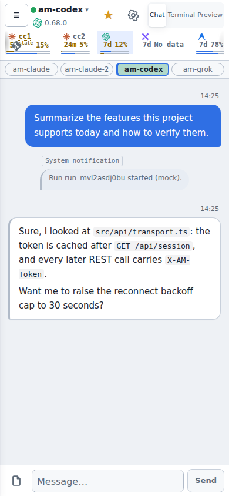

# AG Man (agents-manager)

English | [繁體中文](README.zh-TW.md) | [简体中文](README.zh-CN.md) | [日本語](README.ja.md)

AG Man is a web UI, running on your own machine, for managing several coding-agent CLIs at once: **Claude Code (`claude`), Codex (`codex`), Grok (`grok`) and Antigravity (`agy`)**. Each CLI session running in a [herdr](https://herdr.dev) pane becomes a **bot** in the web UI. You can follow conversations, answer prompts and watch quota from a browser or phone, and let several bots work together.

AG Man is not an IDE, and it does not start agents itself. herdr manages the terminals; the daemon (`agents-managerd`) talks to herdr and receives replies through each CLI's hooks.

> The screenshots use the built-in mock backend (`VITE_MOCK=1`); accounts, bots and messages are demo data.



## Key features

**Chat with agents instead of watching terminals**
- One bot per CLI session, grouped by project directory. Send messages from the browser, queue them while a turn is running, interrupt or force-stop.
- Replies come from the CLI's hooks or native transcripts. If the daemon has to fall back to reading the terminal snapshot, the reply is marked "possibly incomplete".
- Confirmations and multiple-choice questions become clickable cards. You can rewind a conversation, fork a bot to continue its context, and wake a bot that was put to sleep.

**Coordinate several bots**
- **Expert mode** (per project): one top-level manager, and the other members are executors, advisors, schedulers or specialists. In expert mode no child agents are started; the manager dispatches work to members of the same project.
- **Cluster dispatch**: executors in the same project with the same kind, model, effort and identity are grouped into a cluster, which can receive work together.
- **Child agents**: agents started through herdr appear under their parent bot. The parent is notified when a child finishes or gets stuck.
- **Supervisor (AGM)**: an optional coordinator bot that patrols the fleet, dispatches work, puts idle bots to sleep and handles deploys. See [SPEC §18](docs/SPEC.md).

**Schedules and push notifications**
- Project schedules: one-off, fixed interval, daily, weekly, and multi-slot runs. Scheduled prompts are sent to a dedicated scheduler bot, and a run ledger is kept.
- Web Push: notifications for finished turns, turns that need a response, schedule outcomes, new versions and quota resets. Each can be switched on or off in settings. If you have already read a message on any device, it is not pushed.

**Remote hosts and account quota**
- Projects can live on SSH hosts and run through that host's herdr: remote bots, host shells, CLI login, quota, and handing a project over to another daemon.
- Claude identities `cc0`–`cc6` are discovered automatically from shell aliases (one set per host), and can be logged in or disabled with one click.
- Quota and reset times are shown per host and per identity, with warnings when quota is low. What is available depends on each CLI (Claude, Codex and Grok are the most complete; agy shows only its Gemini bucket).
- Model, effort and fast mode can be switched live in the web UI where the CLI supports it.

**Updates and maintenance**
- The "Update check" page lists the herdr version, each agent CLI and each hook integration on every host, with one-click updates.
- Idle bots are put to sleep after a configurable period, keeping only what is needed to resume them.

**Workspace and guard rails**
- Preview a bot's local dev server next to the chat.
- A file shelf for temporary files shared across bots, and an outbox for downloadable files produced by bots.
- A memory view of the herdr process tree.
- A built-in hook blocks broad `pkill`/`kill` commands that would take down other agents.

**Chinese and English UI**: follows the browser language by default; switch under Settings → Display.

More detail and limits are in [`docs/SPEC.md`](docs/SPEC.md).

**Not provided**: a code editor, diff / PR review, and git worktree management (agents handle these according to each repo's conventions).

## Supported platforms

| Platform | Status |
|---|---|
| macOS (arm64) | Daemon and web UI supported |
| Linux (x86_64, arm64) | Daemon and web UI supported |
| Windows | No native Windows daemon. Install and run inside **WSL2** (a Linux distribution); open the web UI from a Windows browser |

The web UI works in any modern browser, on desktop and on phones.

## Requirements and installation

**Required** (the Homebrew and prebuilt-archive methods install herdr automatically; the rest you provide yourself)

| Tool | Purpose |
|---|---|
| [herdr](https://herdr.dev) | Terminal workspace manager. The daemon uses its Unix socket to open panes, start agents, send text and read the screen. Check with `herdr --version`; the "Update check" page in settings compares versions. |
| At least one agent CLI: `claude`, `codex`, `grok` or `agy` | The agents you want to manage. Log in to each one locally first. |
| Rust toolchain (`cargo`) | Only needed when building from source. |
| [Bun](https://bun.sh) | Only needed when building from source (to build the web front end). |

**Recommended** (the host environment check lists these and prompts you if they are missing)

| Tool | Purpose |
|---|---|
| `rtk` | Token-compression proxy; Claude's hook rewrites ordinary commands to use it. |
| `zsh`, `jq` | Used by the host shell and hook scripts. |
| `gh` | Shows the GitHub CLI login status. |

**Optional**: the Blaze build engine speeds up development builds; see [`docs/BUILD-CACHE.md`](docs/BUILD-CACHE.md). A Claude API key and the Jev judge layer are optional features and are off by default.

## Quick start

**Option 1: Homebrew (macOS and Linux; also installs herdr)**

```bash
brew install eden-sun/tap/agents-manager
brew services start agents-manager    # stop: brew services stop agents-manager
```

The service starts automatically at login and keeps running. To run in the foreground instead: `agents-managerd serve` (Ctrl-C to stop). The log is at `$(brew --prefix)/var/log/agents-manager.log`. The service only sees Homebrew's `bin` and `~/.local/bin`; if your agent CLIs are installed elsewhere, run the daemon in the foreground from your shell instead.

**Option 2: prebuilt binary** (the web UI is embedded). Download the archive for your platform from [Releases](https://github.com/Eden-Sun/agents-manager/releases/latest): `linux-x86_64`, `linux-arm64` or `macos-arm64`.

```bash
VERSION=v0.1.0          # use the latest version shown on the Releases page
ASSET=linux-x86_64      # or linux-arm64 / macos-arm64
curl -fLO "https://github.com/Eden-Sun/agents-manager/releases/download/$VERSION/agents-managerd-$VERSION-$ASSET.tar.gz"
tar -xzf "agents-managerd-$VERSION-$ASSET.tar.gz"
install -m 755 "agents-managerd-$VERSION-$ASSET/agents-managerd" ~/.local/bin/
agents-managerd serve
```

Each archive has a `.sha256` file beside it for verification. On macOS, a downloaded binary may need `xattr -d com.apple.quarantine ~/.local/bin/agents-managerd` once. The archive does not include the scripts under `scripts/` (such as `agm`); clone the source if you need them.

**Option 3: build from source** (development, or a platform not listed above). Clone first:

```bash
git clone https://github.com/Eden-Sun/agents-manager.git
cd agents-manager

# 1. Build the web front end (it is embedded in the daemon)
(cd web && bun install && bun run build)

# 2. Build the daemon
cargo build --release -p agents-managerd

# 3. Start (foreground; Ctrl-C to stop)
./target/release/agents-managerd serve
```

With any of these options, open **http://127.0.0.1:7788** in a browser. Opening it from `127.0.0.1` signs you in automatically; from another device, paste the contents of `~/.config/agents-manager/ui-token`.

To look at the interface without herdr or the daemon, use the mock backend:

```bash
cd web && bun install && VITE_MOCK=1 bun run dev
```

For long-running use, Homebrew's `brew services` manages the daemon for you. Otherwise use a systemd user unit, launchd, or a herdr pane. For scheduling details on Linux hosts, see [SPEC §18.2e](docs/SPEC.md).

## First steps

1. **Add a project**: click "Add Project" at the bottom of the sidebar, choose a directory on this machine or on an SSH host, and give it a label.
2. **Add a bot**: open the project's "+" menu, choose "Add Bot", pick the kind (`claude`, `codex`, `grok` or `agy`), and optionally an identity and model. The daemon opens a herdr pane there, starts the CLI and attaches the hooks.
3. **Chat**: type and send a message in the input box. Messages sent while a turn is running are queued; confirmations and multiple-choice questions appear as cards; the stop button interrupts the turn. Switch to the "Terminal" tab to see the raw pane.
4. **Let bots delegate**: if a bot runs `herdr agent start …`, the child agent is listed under it and the bot is notified when the child finishes or gets stuck.
5. **Automate**: the same "+" menu has "Add Schedule". Quota, model lists, update checks and hosts are under Settings.
6. **Open it on your phone**: on the same network (LAN or Tailscale), open `http://<this machine's address>:7788` and paste the contents of `ui-token`.

## Supported agent CLIs

Each CLI gets a hook injected at launch, so replies arrive as structured events instead of being scraped from the screen.

| Kind | Reply source | Notes |
|---|---|---|
| `claude` | `--settings` hooks (`SessionStart`／`Stop`) | Identities `cc0`–`cc6`; model and effort can be switched live |
| `codex` | `notify` hook set at each launch | Model, effort and Fast can be switched live |
| `grok` | Hook file in `GROK_HOME` | Model can be switched live; effort needs a restart; see [SPEC §12](docs/SPEC.md) |
| `agy` | Named hooks in the Antigravity CLI settings | Update prompt shown in the header; see [SPEC §12a](docs/SPEC.md) |

Hook details are in [`docs/HOOK.md`](docs/HOOK.md).

## Configuration and data

Default location: `~/.config/agents-manager/` (override with the `AM_DATA_DIR` environment variable).

| File | Contents |
|---|---|
| `config.toml` | Desired state: projects, bots, hosts and settings. It is the source of truth. |
| SQLite database | Runtime state: turns, messages, schedule records and so on. |
| `ui-token` | Token for signing in to the web UI; mode 0600. |

Example configuration (values and paths are illustrative):

```toml
[server]
listen = "127.0.0.1:7788"
herdr_session = "agents-manager"

[[projects]]
id = "01EXAMPLE000000000000000000"
path = "/home/example/project/foo"
label = "foo"

  [[projects.bots]]
  id = "01EXAMPLE000000000000000001"
  name = "foo-claude"
  kind = "claude"
```

- Data lives next to the config file: when you point `--config` at another path, the database and `ui-token` follow that directory (or `[server] data_dir`); the two must match.
- Writing back to `config.toml` keeps your comments and layout.
- Settings tabs: Setup, Hosts, Update check, Identities, Recently deleted, Jev suggestions, Claude API and Display.

Full field reference: [SPEC §5](docs/SPEC.md).

## Security notes

- **Network binding**: the packaged macOS app binds only to `127.0.0.1`. In other cases (including running `agents-managerd serve` directly), the daemon binds all interfaces by default so that phones on the same network can connect. To keep it local only, set `AM_DEV_LAN=0`.
- **ui-token**: whoever holds it has full control of the web UI, including starting and stopping bots. Never commit it to git or paste it anywhere public. The LAN risk of the shared token is a deliberate design trade-off; see [API.md §0](docs/API.md).
- **Data stays local**: conversations, settings and the database live on your machine. Projects on remote hosts are accessed over SSH and their data stays on that host.
- **Third-party services are off by default**: the Claude API (one-off LLM jobs, changelog triage, message translation), the Jev judge layer (external API key) and the sharing entry point must each be turned on explicitly. The translate button only spends money when you click it. Simplified-to-Traditional Chinese conversion happens locally and does not call any API.
- **Web Push**: notifications are delivered through the browser vendor's push service. The content is encrypted, but the push service can see when and to whom notifications are sent. You can turn them off in settings.
- **Shared bots**: sharing links let restricted or trusted bots be used by other people through a separate entry point; see [SPEC §20](docs/SPEC.md).
- **Broad-kill guard**: a hook blocks `pkill`/`kill` commands that could terminate other agents. Do not work around it by writing the same command differently.

## Development and verification

```bash
scripts/check.sh changed    # verify only what changed relative to origin/main (run before committing)
scripts/check.sh web        # TypeScript, lint, front-end tests and build
scripts/check.sh daemon     # cargo tests for the daemon, xtask and crates
scripts/check.sh ops        # shell-script lint and isolated tests
```

- Development mode: `cargo dev` starts the daemon (`0.0.0.0:7788`) and the Vite dev server (`0.0.0.0:5173`) together; `cargo down` stops both.
- Front-end commands and conventions: [`docs/FRONTEND.md`](docs/FRONTEND.md) and [`web/README.md`](web/README.md).
- Verification and CI workflow: [`docs/AGENT-VERIFY.md`](docs/AGENT-VERIFY.md).

## Documentation index

| Document | Contents |
|---|---|
| [`docs/SPEC.md`](docs/SPEC.md) | Specification of current behavior: data model, hooks, reconciliation, remote hosts, quota, identities, supervisor, clusters, schedules |
| [`docs/API.md`](docs/API.md) | HTTP / WebSocket contract, including bot and service authorization scopes |
| [`docs/UI-DECISIONS.md`](docs/UI-DECISIONS.md) | Settled interface trade-offs |
| [`docs/FRONTEND.md`](docs/FRONTEND.md) | Front-end structure, commands and conventions |
| [`docs/HOOK.md`](docs/HOOK.md) | Hook subcommand contract and timing tests |
| [`docs/AGENT-VERIFY.md`](docs/AGENT-VERIFY.md) | Verification and CI workflow |
| [`docs/BUILD-CACHE.md`](docs/BUILD-CACHE.md) | Blaze development builds and sccache dependency cache |
| [`docs/PACKAGING.md`](docs/PACKAGING.md) | Packaging the macOS `.dmg` |
| [`docs/CLAUDE-NATIVE-TRANSPORT.md`](docs/CLAUDE-NATIVE-TRANSPORT.md) | Evaluation of Claude-native transport versus herdr |
| [`docs/CHATGPT-CONSULT.md`](docs/CHATGPT-CONSULT.md) | Optional ChatGPT web consult worker |
| [`web/README.md`](web/README.md) | Front-end quick commands |

## License

[MIT](LICENSE)
