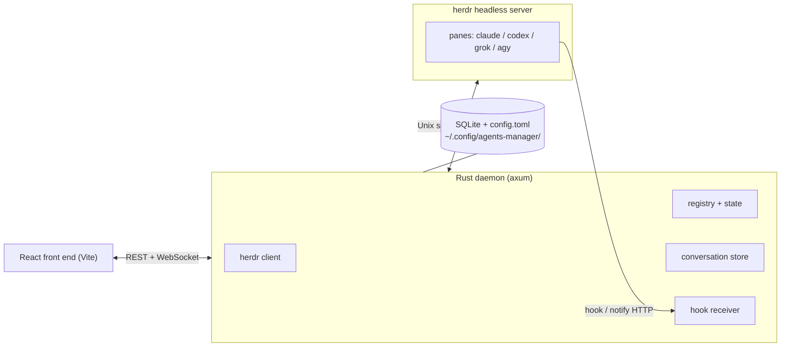

# agents-manager

**English** | [繁體中文](README.zh-TW.md)

A local manager for coding-agent CLIs. The web UI turns every **claude** / **codex** / **grok** / **agy** session running in a [herdr](https://herdr.dev) pane into a "bot", groups bots by project directory, and lets you chat with them, answer blocked prompts and watch quota from the browser or your phone.

The screenshots below come from the built-in mock backend (`VITE_MOCK=1`), so every account, bot and message is demo data. The UI itself is currently in Traditional Chinese.


## Features

- **Chat per bot** — send messages, queue them while a turn runs, interrupt or force-stop; replies are collected from CLI hooks, with a terminal-snapshot fallback marked as possibly incomplete. See [SPEC §4](docs/SPEC.md).
- **Blocked prompts** — confirmations and multiple-choice questions become clickable cards instead of a terminal you have to open. [UI decisions](docs/UI-DECISIONS.md).
- **Jev suggestions** — an optional judge layer can score the options of a question and flag them as "Jev suggestion"; it only suggests and never answers for you. [SPEC §4.3c](docs/SPEC.md).
- **Projects and groups** — bots grouped by directory, `@bot` / `@all` group chat, and group tasks with plan / execute / review / verify / deliver cards. [SPEC §13](docs/SPEC.md).
- **Child agents** — children started through herdr are tracked under their parent bot with status and progress notices. [SPEC §6.5a](docs/SPEC.md).
- **Project schedules** — one-off, interval, daily and weekly runs queued into an existing bot, with run history and copy-to-new. [SPEC](docs/SPEC.md).
- **Model, effort and identity** — per-host model lists; apply model / effort live where the CLI allows it; Claude `cc0`–`cc6` identities discovered from shell aliases. [SPEC §4.4a](docs/SPEC.md).
- **Quota** — per-host, per-identity short and weekly windows for Claude, Codex, grok and agy, with low-quota warnings. [SPEC §14](docs/SPEC.md).
- **Remote hosts** — projects on other machines run over SSH against that host's herdr, with host shells and CLI login. [SPEC §11](docs/SPEC.md).
- **Update checks** — one settings tab lists herdr, agent CLIs and hook integrations per host, with one-click updates (including agy). [SPEC §6.9c](docs/SPEC.md).
- **AGM supervisor** — an optional coordinator bot that patrols the fleet, dispatches work and handles deploys. [SPEC §18](docs/SPEC.md).
- **Claude API** — an optional API key lets one-off LLM jobs (update triage, changelog translation) skip a full Claude Code session. [SPEC §4.3d](docs/SPEC.md).
- **Files and sharing** — a cross-bot scratch tray, downloadable bot outputs, and restricted share bots. [SPEC §20](docs/SPEC.md).

## Quick start

Requirements: Rust (`cargo`), [Bun](https://bun.sh), an installed [herdr](https://herdr.dev), and at least one agent CLI (`claude`, `codex`, `grok` or `agy`).

```bash
git clone git@github.com:Eden-Sun/agents-manager.git
cd agents-manager

# Start the daemon (0.0.0.0:7788) and the Vite dev server (0.0.0.0:5173)
cargo dev
# Stop both
cargo down
```

Without herdr, you can explore the UI against an in-memory fake backend:

```bash
cd web
bun install
VITE_MOCK=1 bun run dev
```

The production UI is embedded in the daemon binary, so build the front end first:

```bash
cd web && bun install && bun run build && cd ..   # produces web/dist
cargo build --release -p agents-managerd
./target/release/agents-managerd serve            # http://127.0.0.1:7788
```

Config and data live in `~/.config/agents-manager/` (override with `AM_DATA_DIR`): `config.toml`, the SQLite database and `ui-token`. Never commit them. Dev builds bind every interface so a phone on your LAN or Tailscale can connect; packaged macOS apps bind loopback only (`AM_DEV_LAN` overrides either). Before pushing, run `scripts/check.sh changed`; see [`docs/AGENT-VERIFY.md`](docs/AGENT-VERIFY.md).

## Architecture



- **web** (`web/`) — React + Zustand, a pure projection of daemon state.
- **daemon** (`daemon/`, binary `agents-managerd`) — reconciles with herdr, injects hooks, matches turns, projects `config.toml` into SQLite, serves HTTP / WebSocket. It never spawns agent CLIs itself.
- **herdr** — owns the real pane and agent lifecycle, sends prompts, reads the screen.

`config.toml` is the source of truth for desired projects and bots; SQLite holds runtime state (runs, turns, messages).

## Supported agent kinds

| Kind | Reply source | Notes |
|---|---|---|
| **claude** | `--settings` hooks (`SessionStart` / `Stop`) | Identities `cc0`–`cc6`; live model / effort apply |
| **codex** | `notify` hook per launch | Live model / effort / Fast apply |
| **grok** | hook file in `GROK_HOME` | Model applies live, effort needs a restart; [SPEC §12](docs/SPEC.md) |
| **agy** | named hooks in the Antigravity CLI settings | Update prompt in the header; [SPEC §12a](docs/SPEC.md) |

Hook details are in [`docs/HOOK.md`](docs/HOOK.md).

## Documentation

| Document | Contents |
|---|---|
| [`docs/SPEC.md`](docs/SPEC.md) | Specification of current behavior: data model, hooks, reconcile, remote hosts, quota, identities, AGM, group tasks |
| [`docs/API.md`](docs/API.md) | HTTP / WebSocket contract, including bot auth scopes |
| [`docs/FRONTEND.md`](docs/FRONTEND.md) | Front-end structure, commands and non-obvious conventions |
| [`docs/UI-DECISIONS.md`](docs/UI-DECISIONS.md) | Settled UI trade-offs |
| [`docs/HOOK.md`](docs/HOOK.md) | Hook subcommand contract and timing tests |
| [`docs/AGENT-VERIFY.md`](docs/AGENT-VERIFY.md) | Verification and CI workflow for contributors and agents |
| [`docs/BUILD-CACHE.md`](docs/BUILD-CACHE.md) | Shared sccache build cache across worktrees |
| [`docs/PACKAGING.md`](docs/PACKAGING.md) | Packaging the macOS `.dmg` |
| [`docs/CLAUDE-NATIVE-TRANSPORT.md`](docs/CLAUDE-NATIVE-TRANSPORT.md) | Evaluation of Claude-native messaging versus herdr |
| [`docs/CHATGPT-CONSULT.md`](docs/CHATGPT-CONSULT.md) | Optional ChatGPT web consult worker |
| [`web/README.md`](web/README.md) | Front-end quick commands |

Docs describe the current state only; history lives in git.
