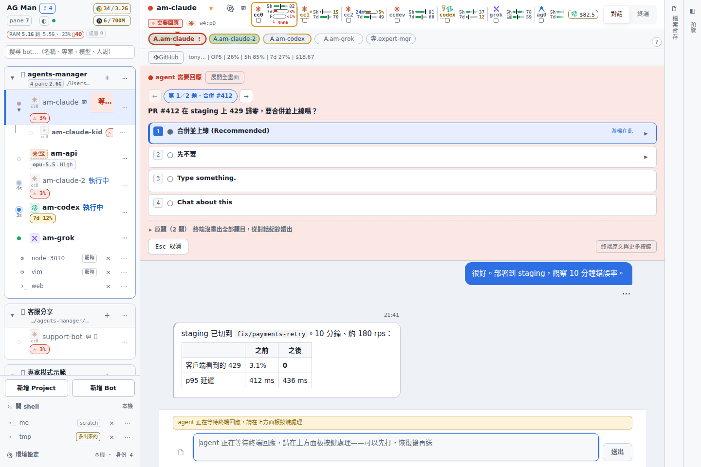
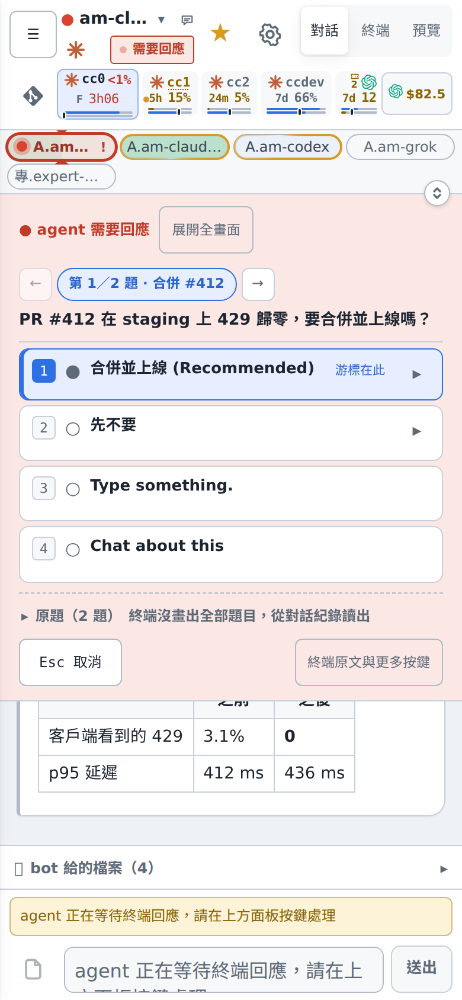

# AG Man（agents-manager）

[English](README.md) | [繁體中文](README.zh-TW.md) | 简体中文 | [日本語](README.ja.md)

**一个网页，管好你所有的 coding agent。**
Claude Code、Codex、Grok、Antigravity 与 API 模型，跑在你自己的机器上；坐在电脑前或拿着手机都能管。

<table>
  <tr>
    <td width="75%"></td>
    <td width="25%"></td>
  </tr>
</table>

<sub>截图使用内置的假数据后端，账号、bot 与消息都是示范数据；界面目前提供英文与繁体中文。</sub>

同时跑好几个 agent CLI，就得在一堆终端标签页之间切来切去，漏看那个卡在 yes/no 问题上一小时的 agent，还得猜额度还剩多少。AG Man 把每个 agent 会话收进一个自托管的网页，有 agent 需要你时会提醒你，也能让 agent 之间互相派活。它用的是你已经付费的 CLI 订阅；API key 是可选的。

- **用手机让卡住的 agent 继续跑。** agent 做完或提问时收到推送，点一下就能回答。
- **一眼看完所有 agent，知道谁在等你。** 每个会话都是一段对话，按项目分组，标示执行中、等你回应或已完成。
- **所有账号的额度一次看。** 同一个 CLI 可以挂多个订阅；用量、重置时间与 Anthropic／OpenAI API 余额都在同一排。
- **让 bot 组队工作。** 由一个管理者 bot 把任务交给执行者 bot，并向顾问 bot 要第二意见。
- **你的每台机器都能用。** 项目可以放在 SSH 主机上，用起来和本机一样。

## 工作方式

AG Man 是一个小 daemon（`agents-managerd`）加一个网页界面。agent CLI 跑在 [herdr](https://herdr.dev) 里，herdr 是一个带 API 的终端工作区管理器；daemon 会自己启动并操作 herdr，你完全不用碰它。回复通过各 CLI 的 hook 传回来，所以你看到的是真正的对话消息和可点的选择题卡片，而不是从终端画面抓下来的文字。API bot 用你的 API key 跑在 daemon 里，不需要终端。

会话在 daemon 那边，不在浏览器：关掉标签页 agent 照样在干活；之后用任何设备打开，接着看下去。AG Man 只管 agent；你的编辑器、git 和仓库约定都不用改。

## 支持的 agent

| Agent | 说明 |
|---|---|
| Claude Code（`claude`） | Anthropic 的 coding CLI |
| Codex（`codex`） | OpenAI 的 coding CLI |
| Grok（`grok`） | xAI 的 coding CLI |
| Antigravity（`agy`） | Google 的 coding CLI |
| Claude API（`claude-api`） | 用你的 key 直连 Anthropic API；用来提问和要第二意见，不能改文件 |
| OpenAI API（`openai-api`） | 用你的 key 直连 OpenAI API；用来提问和要第二意见，不能改文件 |

模型与推理强度实时从各 CLI 或供应商读取，CLI 支持的话可以直接在网页上切换。

## 功能

- **对话里：** 回合进行中发送的消息会排队；可以中断、回退，或 fork 一个 bot 接着原来的上下文做。原始终端画面切一个标签就能看到。
- **团队角色（专家模式）：** 在一个项目里，由一个管理者 bot 派活给执行者 bot、向顾问 bot 请教。相同配置的执行者组成一组，活交给空闲的那个。bot 开的子 agent 会挂在它下面，做完或卡住时会通知它。
- **定时任务：** 单次、固定间隔、每天或每周发送提示，并保留执行记录。
- **分享与文件：** 用链接把 bot 分享给别人用，权限受限。bot 产生的文件放在 outbox；HTML 文件可以直接当网页打开，Antigravity 生成的图片会出现在对话里。文件暂存区可以在 bot 之间传文件。
- **预览：** 在对话旁边看 bot 的 dev server，有手机和 iPad 尺寸。
- **更新：** 每台主机上的 herdr 与各 agent CLI 都能一键更新。
- **语言：** 界面支持英文与繁体中文。

完整行为与限制见 [`docs/SPEC.md`](docs/SPEC.md)。

## 平台与需求

- **macOS（arm64）** 或 **Linux（x86_64、arm64）**。Windows 请在 **WSL2** 里运行，再用 Windows 的浏览器打开界面。
- **[herdr](https://herdr.dev)**。用 Homebrew 安装会自动装好；用预编译的可执行文件或从源码构建时，要先自己装（`herdr --version` 要能运行）。
- 上表**至少一个 agent CLI 或 API key**。
- 从源码构建另外需要 Rust 工具链与 [Bun](https://bun.sh)。

## 快速开始

```bash
brew install eden-sun/tap/agents-manager    # macOS 与 Linux；会一起装 herdr
brew services start agents-manager          # 现在启动，之后每次登录也会自动启动
```

打开 **http://127.0.0.1:7788**。从这台机器打开会自动登录，你会看到侧栏是空的、上方有额度栏的 AG Man 页面。

1. 确认每个 agent CLI 都已登录：在终端里先运行一次，或到 **Settings → Identities** 登录。
2. 点 **Add Project**，选一个目录（这台机器或 SSH 主机上的都可以）。
3. 打开项目的 **+** 菜单，选 **Add Bot**，挑一种 agent。
4. 发送 `hello`。回复会以对话气泡出现，侧栏的 bot 会显示为执行中。

**手机与其他设备：** daemon 会在所有网络接口上监听，所以同一个局域网或 Tailscale 上的手机可以打开 `http://<这台机器的地址>:7788`，粘贴 `~/.config/agents-manager/ui-token` 的内容登录。设置 `AM_DEV_LAN=0` 就只接受本机连接。

**找不到 CLI 时：** Homebrew 的服务只看得到 Homebrew 的 `bin` 与 `~/.local/bin`。先停掉服务（`brew services stop agents-manager`），改在你自己的 shell 里运行 `agents-managerd serve`。日志在 `$(brew --prefix)/var/log/agents-manager.log`。

<details>
<summary><b>其他安装方式：预编译可执行文件或从源码构建</b></summary>

两种都要先装好 [herdr](https://herdr.dev)。

**预编译可执行文件**（已内嵌网页界面；`linux-x86_64`、`linux-arm64` 或 `macos-arm64`）：

```bash
ASSET=linux-x86_64      # 或 linux-arm64 / macos-arm64
VERSION=$(curl -fsSL https://api.github.com/repos/Eden-Sun/agents-manager/releases/latest | grep -m1 '"tag_name"' | cut -d'"' -f4)
curl -fLO "https://github.com/Eden-Sun/agents-manager/releases/download/$VERSION/agents-managerd-$VERSION-$ASSET.tar.gz"
tar -xzf "agents-managerd-$VERSION-$ASSET.tar.gz"
mkdir -p ~/.local/bin && install -m 755 "agents-managerd-$VERSION-$ASSET/agents-managerd" ~/.local/bin/
~/.local/bin/agents-managerd serve
```

每个压缩包在 [Releases](https://github.com/Eden-Sun/agents-manager/releases/latest) 页都有对应的 `.sha256` 可校验。macOS 下载的可执行文件可能要先运行一次 `xattr -d com.apple.quarantine ~/.local/bin/agents-managerd`。

**从源码构建：**

```bash
git clone https://github.com/Eden-Sun/agents-manager.git
cd agents-manager
(cd web && bun install && bun run build)        # 网页界面会内嵌进 daemon
cargo build --release -p agents-managerd
./target/release/agents-managerd serve
```

要长期运行，可以用 systemd user unit、launchd 或 herdr pane。

</details>

**只想先看看？** `git clone` 之后运行 `cd web && bun install && VITE_MOCK=1 bun run dev`，用示范数据打开界面，不需要 daemon 或 herdr。

## 数据与安全

- 配置与历史放在 `~/.config/agents-manager/`（可用 `AM_DATA_DIR` 修改）。远程项目的数据留在那台主机上。
- 该目录里的 `ui-token` 等于整个界面的控制权，请勿泄露。
- 打包好的 macOS app 只监听 `127.0.0.1`；`agents-managerd serve` 默认监听所有接口，设置 `AM_DEV_LAN=0` 才只接受本机。
- 第三方与对外的功能（Claude API、OpenAI API、翻译、分享链接）都要你自己打开才会启用。
- 推送经由浏览器厂商的推送服务发出。内容有加密，但推送服务看得到通知发出的时间。

## 开发

```bash
scripts/check.sh changed    # 只验证相对 origin/main 改动的部分
cargo dev                   # daemon（:7788）＋ Vite dev server（:5173）；cargo down 停止
```

另见 [`docs/FRONTEND.md`](docs/FRONTEND.md)、[`docs/AGENT-VERIFY.md`](docs/AGENT-VERIFY.md) 与 [`docs/BUILD-CACHE.md`](docs/BUILD-CACHE.md)。

## 文档

| 文档 | 内容 |
|---|---|
| [`docs/SPEC.md`](docs/SPEC.md) | 所有行为的规格：bot、hook、主机、额度、身份、团队角色、定时任务 |
| [`docs/API.md`](docs/API.md) | HTTP／WebSocket API |
| [`docs/HOOK.md`](docs/HOOK.md) | 各 CLI 的 hook 如何回报回复 |
| [`docs/UI-DECISIONS.md`](docs/UI-DECISIONS.md) | 已定案的界面取舍 |
| [`docs/PACKAGING.md`](docs/PACKAGING.md) | 打包 macOS `.dmg` |

## 许可证

[MIT](LICENSE)
