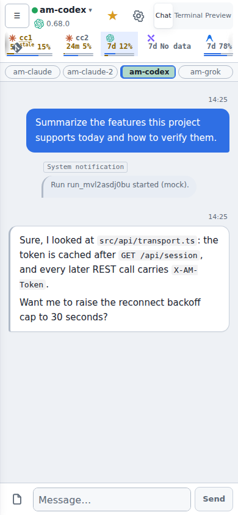

# AG Man（agents-manager）

[English](README.md) | [繁體中文](README.zh-TW.md) | 简体中文 | [日本語](README.ja.md)

AG Man 是一个运行在你自己机器上的网页界面，用来管理多个 coding agent CLI：**Claude Code（`claude`）、Codex（`codex`）、Grok（`grok`）与 Antigravity（`agy`）**。每个在 [herdr](https://herdr.dev) pane 里运行的 CLI 会话，都会变成网页上的一个 **bot**：你可以在浏览器或手机上查看对话、回复提问、查看额度，并让多个 bot 相互协作。

AG Man 不是 IDE，也不自己启动 agent。终端由 herdr 管理；daemon（`agents-managerd`）负责与 herdr 通信，并通过各 CLI 的 hook 接收回复。

> 截图使用内置的假数据后端（`VITE_MOCK=1`），账号、bot 与消息都是演示数据。



## 主要功能

**用对话取代盯终端**
- 每个 CLI 会话对应一个 bot，按项目目录分组。可在浏览器发送消息、回合执行中排队、中断或强制停止。
- 回复来自 CLI 的 hook 或原生 transcript。若 daemon 必须退回读取终端快照，该条回复会标示“可能不完整”。
- 确认与多选题会变成可点选的卡片。可以回退对话（rewind）、fork bot 接续上下文，也能唤醒被收起来的闲置 bot。

**协调多个 bot**
- **专家模式**（项目层级）：指定一位顶层管理者，其他成员为执行者（executor）、顾问（advisor）、排程者（scheduler）或专家（specialist）。专家模式下不开子 agent，改由管理者派工给同项目成员。
- **群集派工**：同项目内 kind、model、effort、identity 相同的执行者会合并为一个群集，可一次派给群集。
- **子 agent**：通过 herdr 启动的子 agent 会挂在父 bot 之下；子 agent 完成或卡住时，父 bot 会收到通知。
- **总管（AGM）**：可选的协调者 bot，负责巡检、派工、收起闲置 bot 与部署。见 [SPEC §18](docs/SPEC.md)。

**排程与推送**
- 项目排程：单次、固定间隔、每日、每周，以及多时段；排程会送进专属的排程 bot，并保留执行记录。
- 网页推送（Web Push）：回合完成、需要回应、排程结束、有新版本或额度重置时通知。可在设置中分别开关；若用户已在任一设备上读过该消息，就不再推送。

**远程主机与账号额度**
- 项目可以放在 SSH 主机上，通过该主机的 herdr 运行：远程 bot、主机 shell、CLI 登录、额度，也能把项目移交到另一台 daemon。
- Claude 身份 `cc0`–`cc6` 会从 shell alias 自动识别（每台主机各一份），可一键登录或停用。
- 额度与重置时间按主机与身份显示；额度偏低时会警示。提供的信息取决于各家 CLI（Claude、Codex、Grok 较完整；agy 只显示 Gemini 额度）。
- 模型、effort、fast mode 在 CLI 支持时可直接在网页切换。

**更新与维运**
- “更新检查”页列出每台主机的 herdr、各 agent CLI 与 hook 集成版本，可一键更新。
- 闲置 bot 在设定的时间后会被收起，只保留恢复所需的信息。

**工作区与防护**
- 可在对话旁预览 bot 的本机 dev server。
- 文件架（跨 bot 暂存）与 outbox（bot 产出的可下载文件）。
- 内存视图：查看 herdr 进程树。
- 内置 hook 会拦截会杀掉其他 agent 的广域 `pkill`／`kill` 命令。

**中英文界面**：默认跟随浏览器语言，可在“设置 → Display”切换。

更多细节与限制见 [`docs/SPEC.md`](docs/SPEC.md)。

**不做的事**：代码编辑器、diff／PR 审查、git worktree 管理（由 agent 按各 repo 惯例自行处理）。

## 支持平台

| 平台 | 状态 |
|---|---|
| macOS（arm64） | 支持 daemon 与网页界面 |
| Linux（x86_64、arm64） | 支持 daemon 与网页界面 |
| Windows | 不支持原生 Windows daemon。请在 **WSL2**（Linux 发行版）内安装与运行，网页从 Windows 浏览器打开即可 |

网页界面可在任何现代浏览器使用，桌面与手机皆可。

## 需求与安装

**必要**（Homebrew 与预先构建的可执行文件方式会自动安装 herdr；其余需自行准备）

| 工具 | 用途 |
|---|---|
| [herdr](https://herdr.dev) | 终端工作区管理器。daemon 通过它的 Unix socket 开 pane、启动 agent、发送文字、读取画面。安装后用 `herdr --version` 确认；设置页的“更新检查”会比对版本。 |
| 至少一个 agent CLI：`claude`、`codex`、`grok` 或 `agy` | 你要管理的 agent。请先在本机登录一次。 |
| Rust 工具链（`cargo`） | 只有从源码构建时需要。 |
| [Bun](https://bun.sh) | 只有从源码构建时需要（构建网页前端）。 |

**建议安装**（主机环境检查会列出，缺少时会提示）

| 工具 | 用途 |
|---|---|
| `rtk` | token 压缩代理；Claude 的 hook 会把一般命令改写成它。 |
| `zsh`、`jq` | 主机 shell 与 hook 脚本使用。 |
| `gh` | 显示 GitHub CLI 登录状态。 |

**可选**：Blaze 构建引擎可加快开发构建，见 [`docs/BUILD-CACHE.md`](docs/BUILD-CACHE.md)。Claude API key 与 Jev 判断层都是可选功能，默认关闭。

## 快速开始

**方式一：Homebrew（macOS 与 Linux，会一并安装 herdr）**

```bash
brew install eden-sun/tap/agents-manager
brew services start agents-manager    # 停止：brew services stop agents-manager
```

服务会在登录后自动启动并保持运行。若想在前台运行：`agents-managerd serve`（Ctrl-C 停止）。Log 位于 `$(brew --prefix)/var/log/agents-manager.log`。服务只会看到 Homebrew 的 `bin` 与 `~/.local/bin`；若你的 agent CLI 装在其他位置，请改在 shell 中以前台方式运行。

**方式二：预先构建的可执行文件**（网页界面已内嵌）。到 [Releases](https://github.com/Eden-Sun/agents-manager/releases/latest) 下载对应平台的压缩包：`linux-x86_64`、`linux-arm64` 或 `macos-arm64`。

```bash
VERSION=v0.1.0          # 请使用 Releases 页面上最新的版本号
ASSET=linux-x86_64      # 或 linux-arm64 / macos-arm64
curl -fLO "https://github.com/Eden-Sun/agents-manager/releases/download/$VERSION/agents-managerd-$VERSION-$ASSET.tar.gz"
tar -xzf "agents-managerd-$VERSION-$ASSET.tar.gz"
install -m 755 "agents-managerd-$VERSION-$ASSET/agents-managerd" ~/.local/bin/
agents-managerd serve
```

每个压缩包旁都有 `.sha256` 文件可供核对。macOS 下载的可执行文件可能需要先执行一次 `xattr -d com.apple.quarantine ~/.local/bin/agents-managerd`。压缩包不包含 `scripts/` 下的脚本（例如 `agm`），需要的话请 clone 源码。

**方式三：从源码构建**（开发，或平台不在上面的列表中）。以下以 clone 为例：

```bash
git clone https://github.com/Eden-Sun/agents-manager.git
cd agents-manager

# 1. 构建网页前端（会被嵌入 daemon）
(cd web && bun install && bun run build)

# 2. 构建 daemon
cargo build --release -p agents-managerd

# 3. 启动（前台运行，Ctrl-C 停止）
./target/release/agents-managerd serve
```

无论用哪一种方式，都在浏览器打开 **http://127.0.0.1:7788**。从 `127.0.0.1` 打开会自动登录；其他设备请粘贴 `~/.config/agents-manager/ui-token` 的内容。

想先看界面、不需要 herdr 或 daemon，可以使用假数据后端：

```bash
cd web && bun install && VITE_MOCK=1 bun run dev
```

若要长期运行，Homebrew 的 `brew services` 会代为管理；其他方式可以使用 systemd user unit、launchd，或放在一个 herdr pane 里。Linux 主机的排程细节见 [SPEC §18.2e](docs/SPEC.md)。

## 第一次使用

1. **新增项目**：在侧栏底部点“新增 Project”，选择本机或 SSH 主机上的目录，并取一个标签。
2. **新增 bot**：打开项目的“＋”菜单，选“新增 Bot”，选择 kind（`claude`、`codex`、`grok` 或 `agy`），可选择身份与模型。daemon 会开一个 herdr pane，在里面启动 CLI 并挂上 hook。
3. **对话**：在输入框发送消息。回合执行中发送的消息会排队；确认与多选题以卡片显示；停止按钮可中断回合。需要看原始画面时切到“终端”标签页。
4. **让 bot 相互委派**：bot 若执行 `herdr agent start …`，子 agent 会列在它之下，并在完成或卡住时通知它。
5. **自动化**：同一个“＋”菜单有“新增排程”。账号额度、模型列表、更新检查与主机都在“环境设置”（Settings）里。
6. **用手机打开**：在同一网络（LAN 或 Tailscale）上，用 `http://<本机地址>:7788` 打开，并粘贴 `ui-token`。

## 支持的 agent CLI

每个 CLI 在启动时会被注入 hook，因此回复是结构化事件，而不是从画面抓取文字。

| kind | 回复来源 | 备注 |
|---|---|---|
| `claude` | `--settings` 的 hook（`SessionStart`／`Stop`） | 身份 `cc0`–`cc6`；模型与 effort 可即时切换 |
| `codex` | 每次启动时的 `notify` hook | 模型、effort、Fast 可即时切换 |
| `grok` | `GROK_HOME` 内的 hook 文件 | 模型可即时切换；effort 需重启，见 [SPEC §12](docs/SPEC.md) |
| `agy` | Antigravity CLI 设置中的具名 hook | 更新提示显示在标题栏；见 [SPEC §12a](docs/SPEC.md) |

hook 细节见 [`docs/HOOK.md`](docs/HOOK.md)。

## 设置与数据位置

默认位置：`~/.config/agents-manager/`（可用环境变量 `AM_DATA_DIR` 覆盖）。

| 文件 | 内容 |
|---|---|
| `config.toml` | 期望状态：项目、bot、主机、设置。是事实来源。 |
| SQLite 数据库 | 运行时状态：回合、消息、排程记录等。 |
| `ui-token` | 网页登录用的 token，权限为 0600。 |

设置示例（数值与路径仅为示意）：

```toml
[server]
listen = "127.0.0.1:7788"
herdr_session = "agents-manager"

[[projects]]
id = "01EXAMPLE000000000000000000"
path = "/home/example/project/foo"
label = "foo"

  [[projects.bots]]
  id = "01EXAMPLE000000000000000001"
  name = "foo-claude"
  kind = "claude"
```

- 数据跟着设置文件走：用 `--config` 指向其他路径时，数据库与 `ui-token` 会跟着该目录（或 `[server] data_dir`），两者必须一致。
- 写回 `config.toml` 时会保留你的注释与排版。
- 设置页（Settings）的分页：Setup、Hosts、Update check、Identities、Recently deleted、Jev suggestions、Claude API、Display。

完整字段见 [SPEC §5](docs/SPEC.md)。

## 安全注意

- **网络绑定**：打包好的 macOS app 只绑定 `127.0.0.1`。其他情况下（包括直接运行 `agents-managerd serve`），daemon 默认绑定所有接口，让同一网络的手机也能连接。若只想供本机使用，请设置 `AM_DEV_LAN=0`。
- **ui-token**：持有它就等于拥有网页的完整权限，包括启动与停止 bot。请勿提交到 git，也请勿贴到公开场合。共用 token 的 LAN 风险是有意保留的设计取舍，见 [API.md §0](docs/API.md)。
- **数据只在本机**：对话、设置与数据库都存放在你的机器上。远程主机的项目则通过 SSH 访问该主机上的数据。
- **第三方服务默认关闭**：Claude API（一次性 LLM 任务、changelog 分诊、消息翻译）、Jev 判断层（外部 API key）与分享入口都需要你明确开启。翻译按钮只有点击时才会产生费用。简体转繁体在本机完成，不调用 API。
- **网页推送**：通知经由浏览器厂商的推送服务送达，内容加密，但推送服务可以看到推送的时间与对象。可在设置中关闭。
- **分享 bot**：分享链接可让受限或受信任的 bot 被其他人使用，属于独立的入口，见 [SPEC §20](docs/SPEC.md)。
- **广域 kill 防护**：hook 会拦截可能杀掉其他 agent 的 `pkill`／`kill` 命令。请不要为了绕过它而改用别的写法。

## 开发与验证

```bash
scripts/check.sh changed    # 只验证相对 origin/main 有改动的部分（提交前运行）
scripts/check.sh web        # TypeScript、lint、前端测试与构建
scripts/check.sh daemon     # daemon、xtask 与 crates 的 cargo 测试
scripts/check.sh ops        # shell 脚本的 lint 与隔离测试
```

- 开发模式：`cargo dev` 同时启动 daemon（`0.0.0.0:7788`）与 Vite dev server（`0.0.0.0:5173`），`cargo down` 停止。
- 前端的命令与惯例见 [`docs/FRONTEND.md`](docs/FRONTEND.md) 与 [`web/README.md`](web/README.md)。
- 验证与 CI 流程见 [`docs/AGENT-VERIFY.md`](docs/AGENT-VERIFY.md)。

## 文档索引

| 文档 | 内容 |
|---|---|
| [`docs/SPEC.md`](docs/SPEC.md) | 当前行为的规格：数据模型、hook、对账、远程主机、额度、身份、总管、群集、排程 |
| [`docs/API.md`](docs/API.md) | HTTP／WebSocket 契约，包含 bot 与服务身份的授权范围 |
| [`docs/UI-DECISIONS.md`](docs/UI-DECISIONS.md) | 已定案的界面取舍 |
| [`docs/FRONTEND.md`](docs/FRONTEND.md) | 前端结构、命令与惯例 |
| [`docs/HOOK.md`](docs/HOOK.md) | hook 子命令的契约与计时测试 |
| [`docs/AGENT-VERIFY.md`](docs/AGENT-VERIFY.md) | 验证与 CI 工作流程 |
| [`docs/BUILD-CACHE.md`](docs/BUILD-CACHE.md) | Blaze 开发构建与 sccache 依赖缓存 |
| [`docs/PACKAGING.md`](docs/PACKAGING.md) | 打包 macOS `.dmg` |
| [`docs/CLAUDE-NATIVE-TRANSPORT.md`](docs/CLAUDE-NATIVE-TRANSPORT.md) | Claude 原生传输与 herdr 的比较评估 |
| [`docs/CHATGPT-CONSULT.md`](docs/CHATGPT-CONSULT.md) | 可选的 ChatGPT 网页咨询 worker |
| [`web/README.md`](web/README.md) | 前端快速命令 |

## 授权

[MIT](LICENSE)
