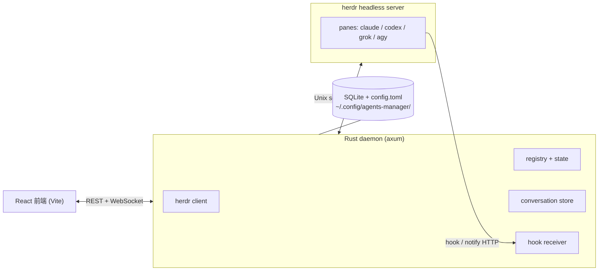

# agents-manager

[English](README.md) | **繁體中文**

管理 coding agent CLI 的本機工具。Web UI 把每個跑在 [herdr](https://herdr.dev) pane 裡的 **claude** / **codex** / **grok** / **agy** 呈現成一個「bot」，以專案目錄分組，讓你在瀏覽器或手機上聊天、處理 blocked 提示並盯額度。

以下截圖來自內建的 mock 後端（`VITE_MOCK=1`），所有帳號、Bot 與訊息都是示範資料。UI 本身目前是繁體中文。


## 功能

- **每個 Bot 的對話** — 送訊息、回合進行中可排隊、可中斷或強制中止；回覆以 CLI hook 為主，終端快照備援會標「可能不完整」。見 [SPEC §4](docs/SPEC.md)。
- **blocked 提示** — 確認與選擇題變成可點選的卡片，不必開終端。見 [UI 決定](docs/UI-DECISIONS.md)。
- **Jev 建議** — 選用的判斷層可替問題的選項評分並標示「Jev 建議」；只是建議，不會代你回答。見 [SPEC §4.3c](docs/SPEC.md)。
- **專案與群組** — 依目錄分組、`@bot` / `@all` 群組聊天，以及有規劃／執行／審查／驗證／交付卡片的群組任務。見 [SPEC §13](docs/SPEC.md)。
- **子 agent** — 經 herdr 開出的 child 會掛在父 Bot 底下，顯示狀態與進度通知。見 [SPEC §6.5a](docs/SPEC.md)。
- **專案排程** — 單次、固定間隔、每天、每週，排進既有 Bot 的佇列，有執行紀錄並可複製成新排程。見 [SPEC](docs/SPEC.md)。
- **模型、強度與身分** — 依主機列出模型；CLI 允許時可在執行中套用模型／強度；Claude 的 `cc0`～`cc6` 身分從 shell alias 自動發現。見 [SPEC §4.4a](docs/SPEC.md)。
- **額度** — 依主機與身分區分，顯示 Claude、Codex、grok、agy 的短期與每週視窗，低額度會警告。見 [SPEC §14](docs/SPEC.md)。
- **遠端主機** — 其他機器上的專案經 SSH 操作那台的 herdr，可開主機 shell 與處理 CLI 登入。見 [SPEC §11](docs/SPEC.md)。
- **更新檢查** — 設定的一個分頁列出每台主機的 herdr、agent CLI 與 hook integration，可一鍵更新（含 agy）。見 [SPEC §6.9c](docs/SPEC.md)。
- **AGM 總管** — 選用的協調者 bot，負責巡檢、派工與部署。見 [SPEC §18](docs/SPEC.md)。
- **Claude API** — 選用的 API key 讓一次性 LLM 工作（更新分診、changelog 翻譯）不必開完整的 Claude Code session。見 [SPEC §4.3d](docs/SPEC.md)。
- **檔案與分享** — 跨 Bot 的檔案暫存、可下載的 Bot 輸出，以及受限的分享 bot。見 [SPEC §20](docs/SPEC.md)。

## 快速開始

需要：Rust（`cargo`）、[Bun](https://bun.sh)、已安裝的 [herdr](https://herdr.dev)，以及至少一種 agent CLI（`claude`、`codex`、`grok` 或 `agy`）。

```bash
git clone git@github.com:Eden-Sun/agents-manager.git
cd agents-manager

# 啟動 daemon（0.0.0.0:7788）與 Vite dev server（0.0.0.0:5173）
cargo dev
# 兩個都停掉
cargo down
```

沒有 herdr 時，可以用記憶體假後端看 UI：

```bash
cd web
bun install
VITE_MOCK=1 bun run dev
```

正式版 UI 內嵌在 daemon 二進位裡，要先建前端：

```bash
cd web && bun install && bun run build && cd ..   # 產出 web/dist
cargo build --release -p agents-managerd
./target/release/agents-managerd serve            # http://127.0.0.1:7788
```

設定與資料在 `~/.config/agents-manager/`（可用 `AM_DATA_DIR` 覆寫）：`config.toml`、SQLite 資料庫與 `ui-token`，不要提交進 git。開發版 daemon 會 bind 所有網卡，讓區網或 Tailscale 上的手機可直接連；打包的 macOS app 只 bind loopback（可用 `AM_DEV_LAN` 覆寫）。推送前跑 `scripts/check.sh changed`，細節見 [`docs/AGENT-VERIFY.md`](docs/AGENT-VERIFY.md)。

## 架構



- **web**（`web/`）— React + Zustand，只是 daemon 狀態的投影。
- **daemon**（`daemon/`，二進位 `agents-managerd`）— 對帳 herdr、注入 hook、配對 Turn、把 `config.toml` 投影進 SQLite、開 HTTP / WebSocket。它不自己啟動 agent CLI。
- **herdr** — 真正的 pane 與 agent 生命週期、送 prompt、讀畫面。

`config.toml` 是期望的 Project / Bot 的權威；SQLite 保存執行期狀態（Run、Turn、Message）。

## 支援的 agent kind

| Kind | 回覆來源 | 備註 |
|---|---|---|
| **claude** | `--settings` hook（`SessionStart` / `Stop`） | 身分 `cc0`～`cc6`；可即時套用模型／強度 |
| **codex** | 每次啟動帶 `notify` hook | 可即時套用模型／強度／Fast |
| **grok** | `GROK_HOME` 裡的 hook 檔 | 模型可即時套用，強度需重啟；見 [SPEC §12](docs/SPEC.md) |
| **agy** | Antigravity CLI 設定中的具名 hook | 標題列有更新提示；見 [SPEC §12a](docs/SPEC.md) |

hook 細節見 [`docs/HOOK.md`](docs/HOOK.md)。

## 文件

| 文件 | 內容 |
|---|---|
| [`docs/SPEC.md`](docs/SPEC.md) | 現行行為規格：資料模型、hook、對帳、遠端主機、額度、身分、AGM、群組任務 |
| [`docs/API.md`](docs/API.md) | HTTP / WebSocket 契約，含 bot 認證範圍 |
| [`docs/FRONTEND.md`](docs/FRONTEND.md) | 前端結構、指令與讀程式看不出來的約定 |
| [`docs/UI-DECISIONS.md`](docs/UI-DECISIONS.md) | 已定案的 UI 取捨 |
| [`docs/HOOK.md`](docs/HOOK.md) | hook 子命令契約與時序測試 |
| [`docs/AGENT-VERIFY.md`](docs/AGENT-VERIFY.md) | 貢獻者與 agent 的驗證與 CI 流程 |
| [`docs/BUILD-CACHE.md`](docs/BUILD-CACHE.md) | 跨 worktree 共用的 sccache 編譯快取 |
| [`docs/PACKAGING.md`](docs/PACKAGING.md) | 打包成 macOS `.dmg` |
| [`docs/CLAUDE-NATIVE-TRANSPORT.md`](docs/CLAUDE-NATIVE-TRANSPORT.md) | Claude 原生訊息與 herdr 的比較評估 |
| [`docs/CHATGPT-CONSULT.md`](docs/CHATGPT-CONSULT.md) | 選用的 ChatGPT 網頁諮詢 worker |
| [`web/README.md`](web/README.md) | 前端快速指令 |

文件只寫現況；歷史看 git。
