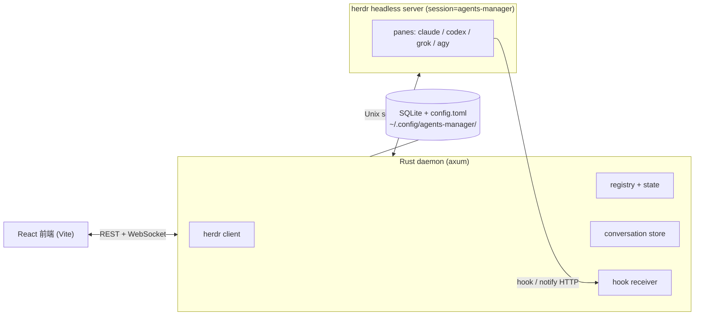
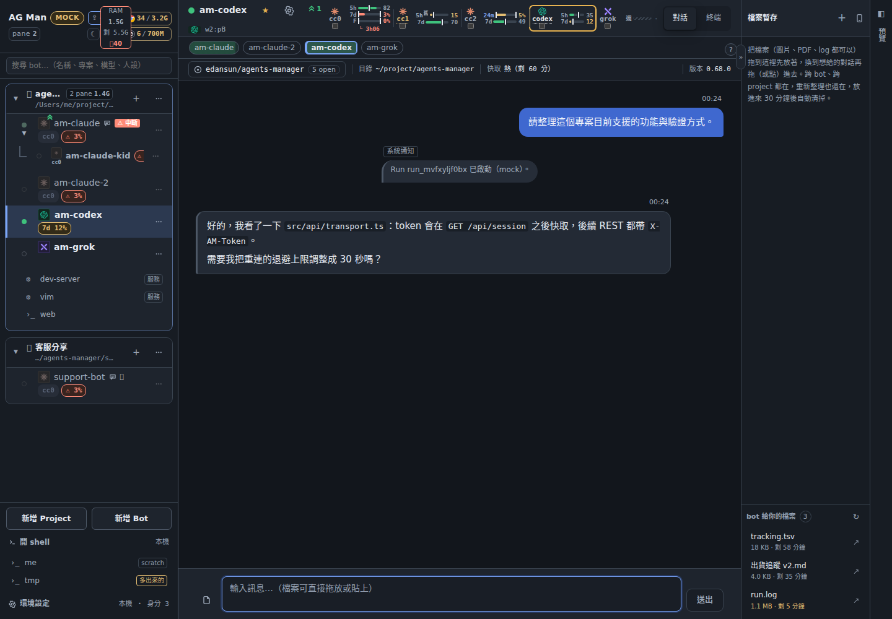
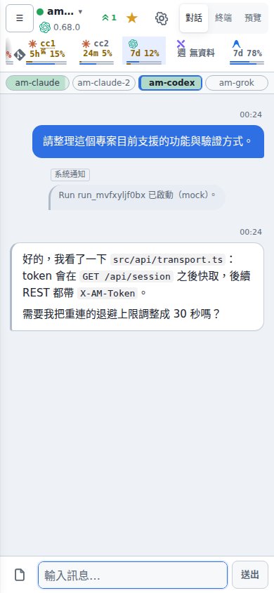
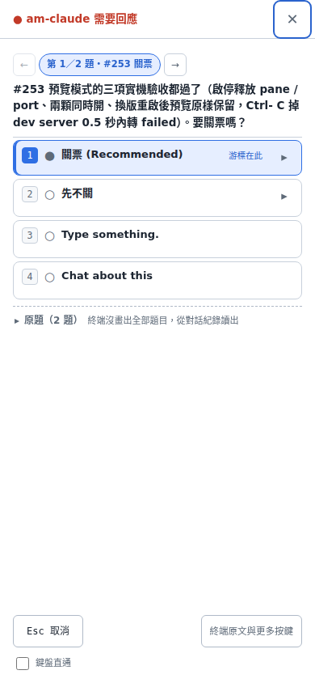
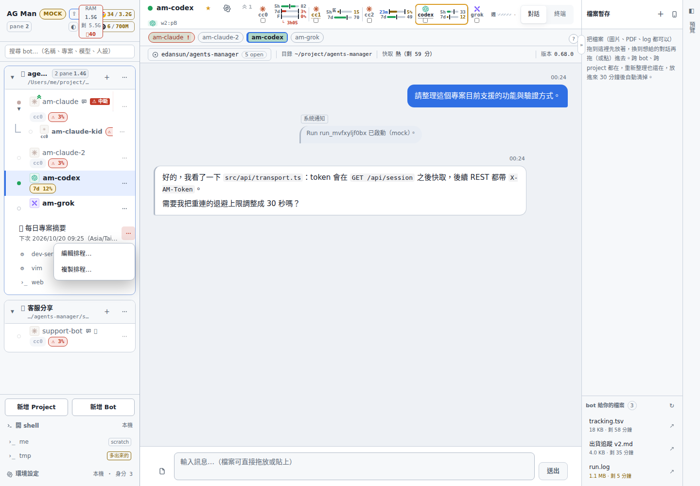
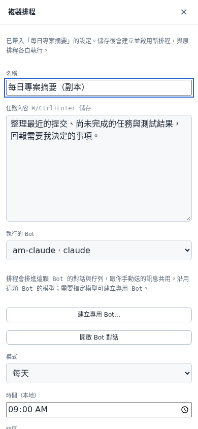

# agents-manager

[English](README.md) | **繁體中文**

本機執行的多 agent 管理器。Web UI 把每個跑在 [herdr](https://herdr.dev) pane 裡的 coding agent CLI（**claude** / **codex** / **grok** / **agy**）呈現成一個「bot」，以目錄為單位分組，用聊天視窗送訊息、看回覆、處理 blocked 提示。

終端裡同時開好幾隻 agent 時，輸出會互相擠、狀態看不清、也沒有跨 bot 的時間軸。這個專案不管 agent 程序本身——那是 herdr 的工作——它負責把它們編成 Project / Bot / Run / Turn，把 hook 回來的回覆收進對話，並在瀏覽器裡操作。

## 架構



三者分工：

| 層 | 做什麼 | 不做什麼 |
|---|---|---|
| **web**（`web/`） | 側欄、對話、群組、群組任務、設定、額度條 | 不直接碰 agent 程序 |
| **daemon**（`daemon/`，二進位 `agents-managerd`） | 對帳 herdr、注入 hook、配對 Turn、投影 TOML→SQLite、開 HTTP / WS | 不直接啟動 agent CLI |
| **herdr** | 真正的 pane / agent 生命週期、送 prompt、讀畫面 | 不理解 Bot / Turn / 群組 |

設定檔 `~/.config/agents-manager/config.toml` 是 Project / Bot **期望設定**的權威；SQLite 保存 Run / Turn / Message 等執行期狀態。daemon 啟動與每次 TOML 寫回後做投影。

## 畫面與功能

以下截圖於 2026-10 使用本地 mock 資料拍攝，呈現目前介面；帳號、Bot、對話與額度皆為示範資料。

**桌面與手機對話** — 側欄按專案分組，顯示 Bot、子 agent、燈號、未讀與排程；Bot 列的 `⋯` 集中操作，支援搜尋、拖曳排序與改暱稱。標題列顯示模型、強度、pane、額度與記憶體資訊。★ 主力列可釘選常用 Bot，對話與終端可隨時切換。



手機版保留對話、主力列與額度條，側欄收進選單。使用者訊息靠右；Bot 回覆、系統通知與其他 Bot 的轉述有各自的來源標示。回覆以 hook 為主，終端備援會標「可能不完整」。Bot 對 Bot 的驗證與來源認領契約見 [API 文件](docs/API.md)。



**需要回應與回合控制** — Bot 停在確認或選單時顯示「需要回應」，可開啟終端操作。Claude 的可辨識問卷會轉成可點選的清單；多題先選好再一次送出，送出前重新比對畫面。辨識不了的提示保留終端原文與按鍵。回合進行中仍可輸入並排隊，也能「中斷回覆」或「強制中止」。完成但尚未閱讀的回合保留未讀徽章。



**專案排程與複製** — 專案的 `＋` 可新增排程，支援單次、固定間隔、每天與每週，指定 Bot、時區及通知方式。排程列顯示下次執行與狀態，點入可看執行紀錄、立即執行或停用；`⋯` 提供編輯與複製。



複製會取得來源最新設定、在名稱加上「副本」，開啟新建表單。儲存才建立並啟用新排程，來源與副本各自執行；不複製執行紀錄，也不另建 Bot。排程沿用所選 Bot 的對話；「跑完就清空對話」會影響該 Bot 的記憶，建議搭配專用 Bot。



**群組聊天與任務** — 點專案名稱進入群組，以 `@<bot>` 或 `@all` 指定收件者，每個 Bot 各自執行回合；沒有 mention 不送出。群組任務另有規劃、執行、審查、驗證與交付的狀態卡。

**模型、強度與帳號** — 選項依該主機的 CLI 能力取得。Claude 可在執行中套用模型／強度，Codex 可套用模型／強度／Fast；Grok 可套用模型，強度需重啟。忙碌或無法套用時會顯示待套用或需要重啟，設定值與實際 runtime 分開呈現，見 [SPEC §4.4a](docs/SPEC.md)。Claude 的 `cc0`～`cc6` 身分可從各主機的 shell alias 自動發現；同名身分跟著所在主機的帳號走。

**額度與遠端主機** — 額度依主機與身分區分，選到遠端 Bot 就切換為那台主機的資料。Claude、Codex 與 agy 顯示各自的短期／每週視窗，Grok 顯示週視窗；畫面上的百分比是「剩餘」，過期讀數另有提示。低額度會在 Bot 列警告。遠端專案透過 SSH 與那台主機的 herdr 操作，也可從主機列開 shell、處理工具登入。

**子 agent 與檔案** — 經 herdr 開出的 child 會縮排在父 Bot 底下，顯示狀態與回報提示；派工規則要求先重用閒置 child，由父 Bot 收尾。右側「檔案暫存」可跨 Bot 暫放圖片、PDF 與 log，重新整理仍保留，放入 30 分鐘後清除；「bot 給你的檔案」則列出可下載的輸出與剩餘保存時間。

## 安裝與啟動

[](https://github.com/Eden-Sun/agents-manager/actions/workflows/ci.yml)

Pull Request、每日排程與手動觸發會跑 GitHub Actions（macOS，daemon 與 web 檢查）；`main` 的每個 push 由 agm-host 的
`scripts/ops/ubuntu-ci.sh` 在背景依各段成功基準驗受影響範圍，預設每 24 小時補完整四段，結果寫成 commit status `ubuntu-ci`。開發收尾前可在 repo 根目錄執行
`scripts/check.sh changed`（只跑改到的部分）或 `scripts/check.sh`（不帶參數，全跑 ob、ops、web、daemon）；`web`／`daemon` 參數可只跑一側。

需要：Rust（`cargo`）、[Bun](https://bun.sh)、已安裝的 [herdr](https://herdr.dev)（支援 socket protocol 20 與 22；0.8.2、0.9.1、0.9.3 實測過），以及至少一種 agent CLI（`claude` / `codex` / `grok` / `agy`）。

```bash
git clone git@github.com:Eden-Sun/agents-manager.git
cd agents-manager

# 一次跑起 daemon（0.0.0.0:7788）+ Vite dev server（0.0.0.0:5173）
cargo dev
# ...
cargo down    # 兩個都停掉
```

> **有 AGM 總管的機器上，5173 看的是已經合併進 `origin/main` 的東西**：dev server 由 AGM 的看門狗維護（不是 `cargo dev` 起的那顆），吃的是一棵只跟 `origin/main` 的乾淨 worktree（每分鐘 `git fetch && git reset --hard origin/main`），推上去重新整理就看得到。bot 要驗自己**還沒提交**的改動請另開自己的 port，不要佔 5173——那是使用者的視窗（[SPEC §18.1](docs/SPEC.md)）。7788 是正式 daemon，前端改動要等下一次 release 重建才會進去。


`cargo dev` / `cargo down` 是 `xtask/` 的別名（見 `.cargo/config.toml`），行為是 `cargo build --bin agents-managerd` + `bun install` 之後，把 daemon 與 `vite --host` 當成一般子行程啟動，PID 記在 `target/dev.pids`，log 在 `target/dev-logs/`。

**開發版的 daemon 一律 bind 每張網卡**（不只 loopback），peer 位址與 Origin 檢查也整個放行（不只 RFC1918——Tailscale 之類 overlay network 用的是 100.64.0.0/10，硬列白名單追不完），這樣同一區網或 Tailscale 上的手機/其他機器可以直接連 `:7788` 或 `:5173`，不必再過 SSH tunnel。**只有打包成 macOS app**（`scripts/package-dmg.sh`，執行檔在 `…app/Contents/MacOS/agents-managerd`）才只 bind `127.0.0.1`、只認本機。

判斷依據是「在不在 .app bundle 裡」而不是環境變數（daemon 一天被重啟幾十次，忘得掉的環境變數不是安全邊界）。要覆寫就用 `AM_DEV_LAN`：`=0` 讓開發版只收本機，`=1` 讓打包版對外開。

也可以手動分開跑，這樣 7788 自己就送 UI，不必另開 Vite：

```bash
# 1. 先建前端：release daemon 預設開 `embed-ui`，編譯當下把 web/dist 內嵌進二進位，所以順序不能反
cd web
bun install
bun run build        # → web/dist
cd ..

# 2. daemon（首次啟動會寫 ~/.config/agents-manager/）
cargo build --release -p agents-managerd
./target/release/agents-managerd serve    # http://127.0.0.1:7788
```

- 跳過第 1 步也編得過，但那顆 daemon 沒有 UI：開 7788 只會拿到一行「web UI not embedded」的 404。之後補 build 前端，還要讓 daemon **重新編譯**才會嵌進去（`crates/am-base/build.rs` 盯著 `web/dist`，正常的 `cargo build` 就會重嵌；見 `crates/am-base/src/assets.rs` 開頭的說明）。
- workspace 裡的 `desktop/`（Tauri 殼）需要 `desktop/binaries/agents-managerd-<triple>` 這個 sidecar，只有 `scripts/package-dmg.sh` 會放進去，所以它不在預設建置範圍：不帶 `-p` 的 `cargo build` / `cargo test` 只建 `daemon` 與 `xtask`。要打包成 app 請看 [`docs/PACKAGING.md`](docs/PACKAGING.md)。

前端要邊改邊看時，daemon 照上面跑，另一個終端開 Vite dev server（把 /api、/hook、/ws 代理到 7788）：

```bash
cd web
bun run dev          # http://localhost:5173
```

開發期也可以 `cargo run -p agents-managerd -- serve`（debug build）。`vite.config.ts` 必須 `changeOrigin: true`：daemon 檢查 `Host` 必須是 `127.0.0.1:<port>` / `localhost:<port>`，不改寫 Host 會拿到 403。

沒有 herdr、只想看 UI：

```bash
cd web
bun install
VITE_MOCK=1 bun run dev
```

設定與資料在 `~/.config/agents-manager/`（可用 `AM_DATA_DIR` 覆寫；`--config` 指到別處時資料目錄會跟著設定檔走，同一個目錄只准一顆 daemon）。`config.toml`、SQLite、`ui-token` 都在那裡，**不要**提交進 git。

## 支援的 agent kind 與 hook

回覆的主要來源是各 CLI 的 hook / notify，終端畫面只是備援。hook 身分是 **per-bot**（`bot_id` + `hook_token`）；注入方式依 CLI 而異，Grok 與 agy 會使用各自的設定目錄。

| kind | 注入方式 | 回覆事件 |
|---|---|---|
| **claude** | 每次啟動 `--settings <daemon 產生的 json>`，內含 `SessionStart` / `Stop` 指到 `agents-managerd hook claude` | stdin JSON；`last_assistant_message` |
| **codex** | 每次啟動 `-c notify=[agents-managerd, hook, codex, …]`（此實例會蓋掉使用者原本的 notify） | argv 最後一個參數是 JSON；`last-assistant-message` |
| **grok** | **沒有**每次啟動的 hook 旗標。daemon 寫入 `<GROK_HOME>/hooks/agents-manager.json` + 固定分派腳本，靠 pane env `AM_BOT_ID` / `AM_HOOK_TOKEN` 找到 bot | stdin JSON，與 claude 同一條子命令 |
| **agy** | 在 Antigravity CLI 設定中登記具名 hooks，靠 pane 環境辨識 Bot | `SessionStart` / `Stop` / `AfterAgent` 等事件；Stop 補取最後一輪對話 |

四種 hook 子命令的契約相同：wall-clock ≤ 3 秒、永遠 exit 0、永遠空 stdout；失敗就 spool 到該 bot 目錄，daemon 重啟後重放。細節見 [`docs/HOOK.md`](docs/HOOK.md) 與規格書 §4、§12。

`inject_hooks = false` 時不注入，回覆改走終端備援，氣泡會標「可能不完整」。pane 太窄時 TUI 會把字排成一欄，備援會拒絕猜、改提示把 pane 拉寬（或移到自己的分頁）。

## 文件

| 文件 | 內容 |
|---|---|
| [`docs/SPEC.md`](docs/SPEC.md) | 規格書（現況）：資料模型、架構、hook、對帳、遠端主機、grok、群組聊天、額度、身份、AGM 運維與群組任務 |
| [`docs/API.md`](docs/API.md) | HTTP / WebSocket 契約（前端以此為準） |
| [`docs/FRONTEND.md`](docs/FRONTEND.md) | 前端結構、驗證指令、讀程式看不出來的約定 |
| [`docs/HOOK.md`](docs/HOOK.md) | hook 子命令契約與時序測試 |
| [`docs/BUILD-CACHE.md`](docs/BUILD-CACHE.md) | 跨 worktree 共用的 sccache 編譯快取：怎麼接上去、大小上限、遠端主機、工具鏈升級的影響 |
| [`docs/CLAUDE-NATIVE-TRANSPORT.md`](docs/CLAUDE-NATIVE-TRANSPORT.md) | native SendMessage/ListAgents 能不能當 Claude↔Claude transport 的評估：能／不能對照、跟 herdr 的差異、為什麼現階段不建議採用 |
| [`docs/PACKAGING.md`](docs/PACKAGING.md) | 打包成 macOS `.dmg`（Apple Silicon、ad-hoc 簽章）|
| [`docs/UI-DECISIONS.md`](docs/UI-DECISIONS.md) | 已定案的 UI 取捨 |
| [`docs/goals/agm-supervisor-persona.md`](docs/goals/agm-supervisor-persona.md) | AGM 人設的內嵌來源（`include_str!` 編進 daemon） |

文件只寫現況；設計演進、驗收紀錄與舊截圖看 git 歷史。

## 現況

- 單 bot 對話、群組 `@mention`、遠端 host（SSH 轉發 + herdr 事件／spool）、額度條、身份、圖片附件與暫存托盤、主機 shell、遠端 gh 登入、子 agent 血緣認領、專案排程與複製，是正在用的路徑。
- 判斷邏輯（專案刪除守門、bot 燈號）抽成純函式，用 `bun test` 跑（測試檔是 `node:test` 寫的，bun 直接吃；`scripts/check.sh web`）；daemon 端 `cargo test -p agents-managerd`，shim 腳本另有 `sh` 測試。
