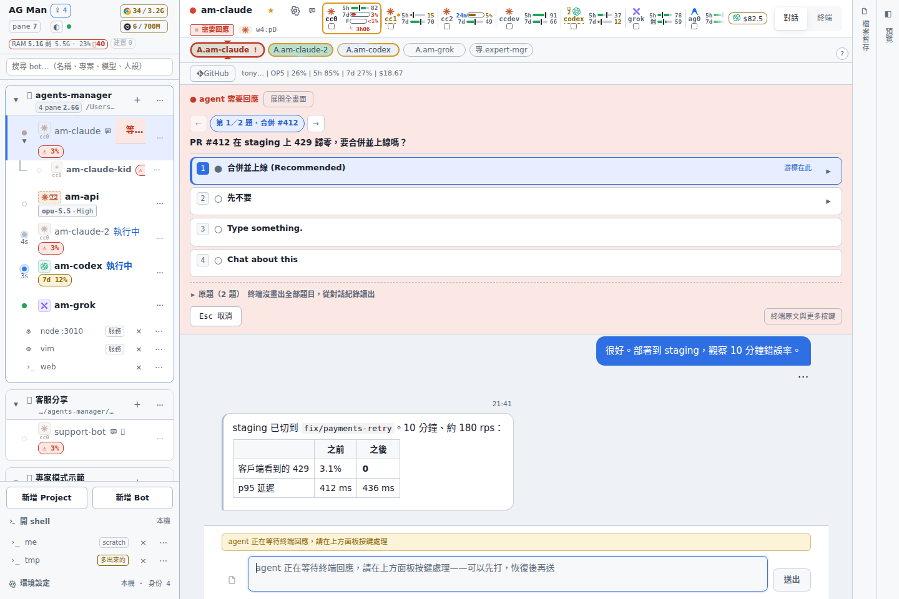
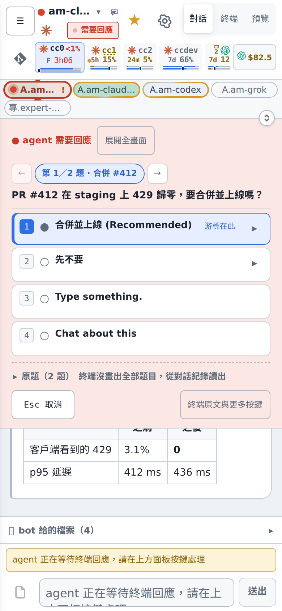

# AG Man（agents-manager）

[English](README.md) | 繁體中文 | [简体中文](README.zh-CN.md) | [日本語](README.ja.md)

**一個網頁，管好你所有的 coding agent。**
Claude Code、Codex、Grok、Antigravity 與 API 模型，跑在你自己的機器上；坐在電腦前或拿著手機都能管。

<table>
  <tr>
    <td width="75%"></td>
    <td width="25%"></td>
  </tr>
</table>

<sub>截圖使用內建的假資料後端，帳號、bot 與訊息都是示範資料。</sub>

同時跑好幾個 agent CLI，就得在一堆終端分頁之間切來切去，漏看那個卡在 yes/no 問題上一小時的 agent，還得猜額度剩多少。AG Man 把每個 agent 工作階段收進一個自架的網頁，有 agent 需要你時會告訴你，也能讓 agent 之間互相派工。它用的是你已經付費的 CLI 訂閱；API key 是選配。

- **用手機讓卡住的 agent 繼續跑。** agent 做完或提問時收到推播，點一下就能回答。
- **一眼看完所有 agent，知道誰在等你。** 每個工作階段都是一段對話，依專案分組，標示執行中、等你回應或已完成。
- **所有帳號的額度一次看。** 同一個 CLI 可以掛多個訂閱；用量、重置時間與 Anthropic／OpenAI API 餘額都在同一排。
- **讓 bot 組隊工作。** 由一個管理者 bot 把任務交給執行者 bot，並向顧問 bot 要第二意見。
- **你的每台機器都能用。** 專案可以放在 SSH 主機上，用起來跟本機一樣。

## 運作方式

AG Man 是一個小 daemon（`agents-managerd`）加一個網頁介面。agent CLI 跑在 [herdr](https://herdr.dev) 裡，herdr 是一個帶 API 的終端工作區管理器；daemon 會自己啟動並操作 herdr，你完全不用碰它。回覆透過各 CLI 的 hook 傳回來，所以你看到的是真正的對話訊息與可點的選擇題卡片，而不是從終端畫面抓下來的文字。API bot 用你的 API key 跑在 daemon 裡，不需要終端。

工作階段在 daemon 那邊，不在瀏覽器：關掉分頁 agent 照樣在做事；之後用任何裝置打開，接著看下去。AG Man 只管 agent；你的編輯器、git 與 repo 慣例都不用改。

## 支援的 agent

| Agent | 說明 |
|---|---|
| Claude Code（`claude`） | Anthropic 的 coding CLI |
| Codex（`codex`） | OpenAI 的 coding CLI |
| Grok（`grok`） | xAI 的 coding CLI |
| Antigravity（`agy`） | Google 的 coding CLI |
| Claude API（`claude-api`） | 用你的 key 直連 Anthropic API；用來提問與要第二意見，不能改檔案 |
| OpenAI API（`openai-api`） | 用你的 key 直連 OpenAI API；用來提問與要第二意見，不能改檔案 |

模型與推理強度即時從各 CLI 或供應商讀取，CLI 支援的話可以直接在網頁上切換。

## 功能

- **對話裡：** 回合進行中送出的訊息會排隊；可以中斷、倒回，或 fork 一顆 bot 接著原本的脈絡做。原始終端畫面切一個分頁就看得到。
- **團隊角色（專家模式）：** 在一個專案裡，由一個管理者 bot 派工給執行者 bot、向顧問 bot 請教。相同設定的執行者會組成一組，工作交給有空的那顆。bot 開的子 agent 會掛在它底下，做完或卡住時會通知它。
- **排程：** 單次、固定間隔、每天或每週送出提示，並留下執行紀錄。
- **分享與檔案：** 用連結把 bot 分享給別人用，權限受限。bot 產生的檔案放在 outbox；HTML 檔可直接當網頁開，Antigravity 產生的圖片會出現在對話裡。檔案暫存區可以在 bot 之間傳檔案。
- **預覽：** 在對話旁邊看 bot 的 dev server，有手機與 iPad 尺寸。
- **更新：** 每台主機上的 herdr 與各 agent CLI 都能一鍵更新。
- **語言：** 介面支援英文與中文。

完整行為與限制見 [`docs/SPEC.md`](docs/SPEC.md)。

## 平台與需求

- **macOS（arm64）** 或 **Linux（x86_64、arm64）**。Windows 請在 **WSL2** 裡執行，再用 Windows 的瀏覽器開介面。
- **[herdr](https://herdr.dev)**。用 Homebrew 安裝會自動裝好；用預先編譯的執行檔或從原始碼建置時，要先自己裝（`herdr --version` 要能執行）。
- 上表**至少一個 agent CLI 或 API key**。
- 從原始碼建置另外需要 Rust 工具鏈與 [Bun](https://bun.sh)。

## 快速開始

```bash
brew install eden-sun/tap/agents-manager    # macOS 與 Linux；會一起裝 herdr
brew services start agents-manager          # 現在啟動，之後每次登入也會自動啟動
```

打開 **http://127.0.0.1:7788**。從這台機器打開會自動登入，你會看到側欄是空的、上方有額度列的 AG Man 頁面。

1. 確認每個 agent CLI 都已登入：在終端機裡先跑一次，或到**環境設定 → 身份**登入。
2. 點**新增 Project**，選一個目錄（這台機器或 SSH 主機上的都可以）。
3. 打開專案的 **+** 選單，選**新增 Bot**，挑一種 agent。
4. 送出 `hello`。回覆會以對話泡泡出現，側欄的 bot 會顯示為執行中。

**手機與其他裝置：** daemon 會在所有網路介面上監聽，所以同一個區網或 Tailscale 上的手機可以打開 `http://<這台機器的位址>:7788`，貼上 `~/.config/agents-manager/ui-token` 的內容登入。設定 `AM_DEV_LAN=0` 就只接受本機連線。

**找不到 CLI 時：** Homebrew 的服務只看得到 Homebrew 的 `bin` 與 `~/.local/bin`。先停掉服務（`brew services stop agents-manager`），改在你自己的 shell 裡跑 `agents-managerd serve`。log 在 `$(brew --prefix)/var/log/agents-manager.log`。

<details>
<summary><b>其他安裝方式：預先編譯的執行檔或從原始碼建置</b></summary>

兩種都要先裝好 [herdr](https://herdr.dev)。

**預先編譯的執行檔**（已內嵌網頁介面；`linux-x86_64`、`linux-arm64` 或 `macos-arm64`）：

```bash
ASSET=linux-x86_64      # 或 linux-arm64 / macos-arm64
VERSION=$(curl -fsSL https://api.github.com/repos/Eden-Sun/agents-manager/releases/latest | grep -m1 '"tag_name"' | cut -d'"' -f4)
curl -fLO "https://github.com/Eden-Sun/agents-manager/releases/download/$VERSION/agents-managerd-$VERSION-$ASSET.tar.gz"
tar -xzf "agents-managerd-$VERSION-$ASSET.tar.gz"
mkdir -p ~/.local/bin && install -m 755 "agents-managerd-$VERSION-$ASSET/agents-managerd" ~/.local/bin/
~/.local/bin/agents-managerd serve
```

每個封存檔在 [Releases](https://github.com/Eden-Sun/agents-manager/releases/latest) 頁都有對應的 `.sha256` 可驗證。macOS 下載的執行檔可能要先跑一次 `xattr -d com.apple.quarantine ~/.local/bin/agents-managerd`。

**從原始碼建置：**

```bash
git clone https://github.com/Eden-Sun/agents-manager.git
cd agents-manager
(cd web && bun install && bun run build)        # 網頁介面會內嵌進 daemon
cargo build --release -p agents-managerd
./target/release/agents-managerd serve
```

要長期執行，可以用 systemd user unit、launchd 或 herdr pane。

</details>

**只想先看看？** `git clone` 之後跑 `cd web && bun install && VITE_MOCK=1 bun run dev`，用示範資料打開介面，不需要 daemon 或 herdr。

## 資料與安全

- 設定與歷史放在 `~/.config/agents-manager/`（可用 `AM_DATA_DIR` 改）。遠端專案的資料留在那台主機上。
- 該目錄裡的 `ui-token` 等於整個介面的控制權，請勿外流。
- 打包好的 macOS app 只監聽 `127.0.0.1`；`agents-managerd serve` 預設監聽所有介面，設 `AM_DEV_LAN=0` 才只接受本機。
- 第三方與對外的功能（Claude API、OpenAI API、翻譯、分享連結）都要你自己打開才會啟用。
- 推播經由瀏覽器廠商的推播服務送出。內容有加密，但推播服務看得到通知送出的時間。

## 開發

```bash
scripts/check.sh changed    # 只驗相對 origin/main 改到的部分
cargo dev                   # daemon（:7788）＋ Vite dev server（:5173）；cargo down 停止
```

另見 [`docs/FRONTEND.md`](docs/FRONTEND.md)、[`docs/AGENT-VERIFY.md`](docs/AGENT-VERIFY.md) 與 [`docs/BUILD-CACHE.md`](docs/BUILD-CACHE.md)。

## 文件

| 文件 | 內容 |
|---|---|
| [`docs/SPEC.md`](docs/SPEC.md) | 所有行為的規格：bot、hook、主機、額度、身份、團隊角色、排程 |
| [`docs/API.md`](docs/API.md) | HTTP／WebSocket API |
| [`docs/HOOK.md`](docs/HOOK.md) | 各 CLI 的 hook 如何回報回覆 |
| [`docs/UI-DECISIONS.md`](docs/UI-DECISIONS.md) | 已定案的介面取捨 |
| [`docs/PACKAGING.md`](docs/PACKAGING.md) | 打包 macOS `.dmg` |

## 授權

[MIT](LICENSE)
