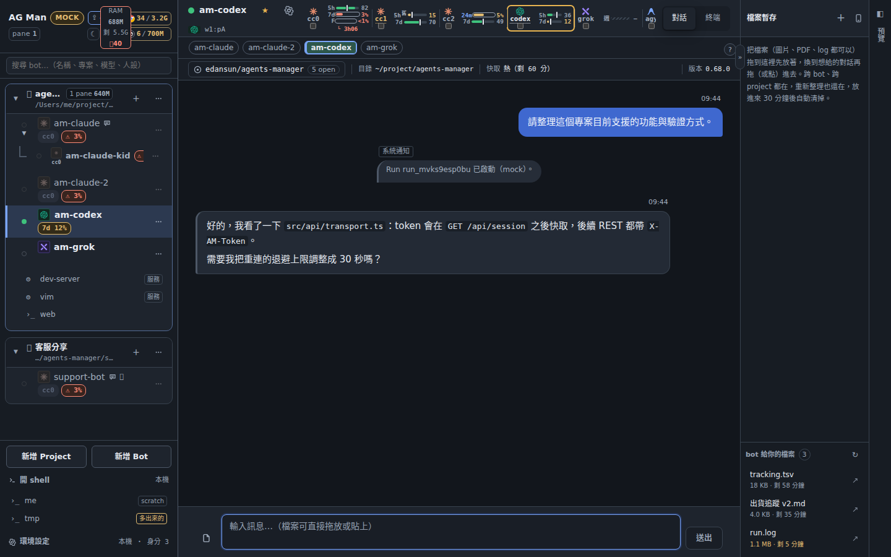
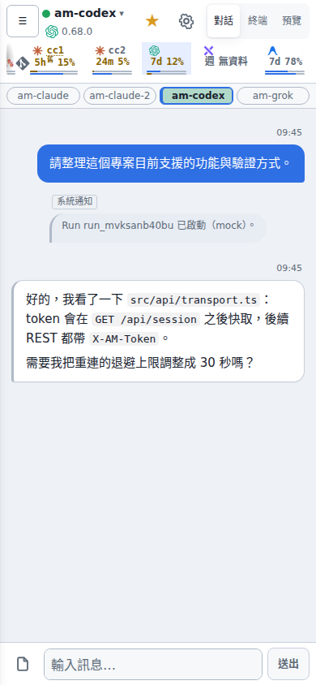
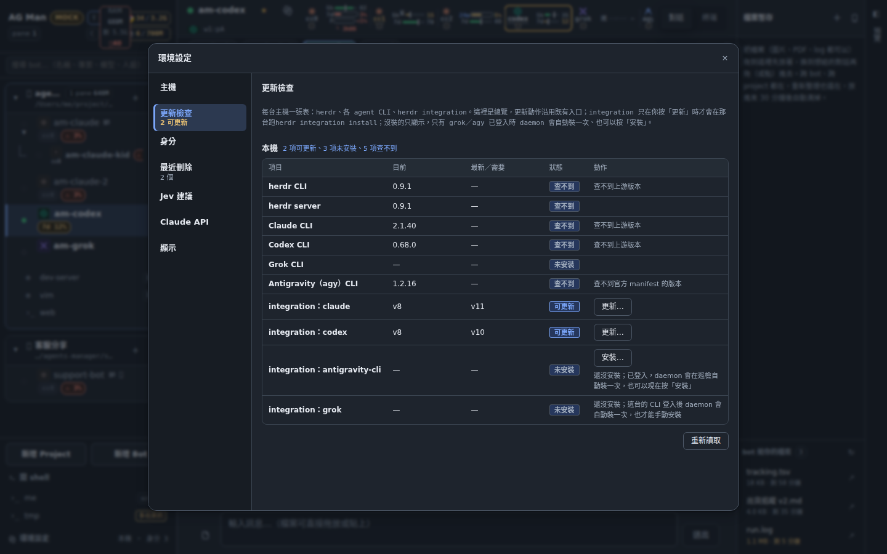
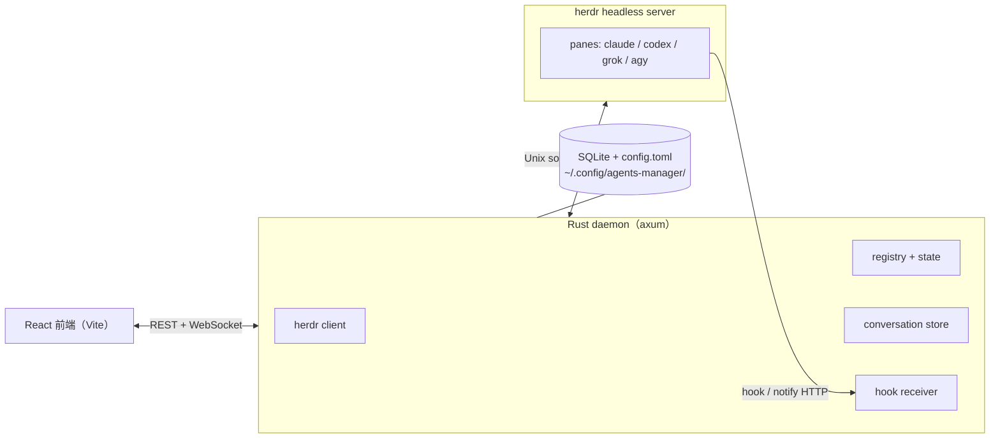

# agents-manager

[English](README.md) | **繁體中文**

從瀏覽器統一管理本機與 SSH 主機上的 coding agent。agents-manager 把每個跑在 [herdr](https://herdr.dev) pane 裡的 **Claude Code**、**Codex**、**Grok**、**Antigravity（agy）** CLI session 變成一顆「Bot」，讓你在桌面或手機上追蹤對話、回應確認、查看額度，並協調多顆 Bot 的工作。它不是 IDE，也不自己 spawn agent：終端由 herdr 擁有，daemon 透過 herdr 與各 CLI 的 hook 工作。



截圖來自內建的 mock 後端（`VITE_MOCK=1`），帳號、Bot 與訊息都是示範資料。UI 目前是繁體中文。

## 主要功能

**用聊天操控 agent，不必盯終端**
- 每個 CLI session 一顆 Bot，依專案目錄分組。從瀏覽器送訊息、回合進行中可排隊、可中斷或強制中止。
- 回覆來自 CLI 自己的 hook 或原生對話紀錄；daemon 必須退回終端快照時，會把那則回覆標成「可能不完整」。
- 確認框與選擇題變成可點的卡片。對話可倒回、可 fork 一顆 Bot 接續脈絡、被收起的 Bot 可 resume。

**協調多顆 Bot**
- 每個專案的 `@bot`／`@all` 群組聊天。
- 經 herdr 開出的子 agent 掛在父 Bot 底下；子 agent 完成或卡住時通知父 Bot。
- 群組任務（mission）：規劃／執行／審查／驗證／交付卡片，由選用的 AGM 總管推動。

**主機、帳號與額度**
- 其他機器上的專案經 SSH 操作那台的 herdr：遠端 Bot、主機 shell、CLI 登入，以及把專案移交給另一顆 daemon。
- Claude 身分 `cc0`～`cc6` 從 shell alias 認出來，每台主機各一份，可一鍵登入與停用。
- 依主機與身分顯示額度與重置時間、低額度警告；內容以各供應商提供的資料為準（Claude、Codex、Grok；agy 只讀 Gemini 桶）。
- CLI 支援時，模型、強度與 fast 模式可在執行中切換。

**自動化**
- 專案排程：單次、固定間隔、每天、每週，排進既有 Bot 的佇列，有執行帳本。
- 每台主機的 herdr、agent CLI 與 hook integration 更新檢查，可一鍵更新。
- 閒置超過設定時間的 Bot 會被收起，只留 resume 所需的資訊。

**工作區與護欄**
- 在對話旁預覽 Bot 的本機 dev server。
- 跨 Bot 的檔案暫存，以及可下載的 Bot 輸出（outbox）。
- herdr 進程樹的記憶體檢視，以及會擋下 `pkill`／`kill` 廣域比對、避免殃及其他 agent 的 hook。

細節與限制見 [`docs/SPEC.md`](docs/SPEC.md)。



## 與 Orca 的比較

[Orca](https://github.com/stablyai/orca)（stablyai）同樣能集中管理多個 coding agent，但兩者中心不同：Orca 是以 git worktree、終端、編輯器與 diff 審閱為中心的桌面 agent 開發環境；agents-manager 是以 Bot 對話、跨主機狀態與 agent 互相派工為中心的 daemon 加 Web UI。下表比較形態，不評優劣。Orca 的欄位依其 README 與文件於 2026-10-23 讀取整理；Orca 每日出版，請以其 changelog 為準。

| | agents-manager | Orca |
|---|---|---|
| 形態 | Rust daemon＋Web UI，單一執行檔；CLI 由 herdr 承載 | Electron 桌面 app，內建終端、編輯器、瀏覽器與 diff 檢視 |
| 平台 | daemon 支援 macOS 與 Linux（沒有 Windows daemon）；UI 用任何瀏覽器 | macOS、Windows、Linux 桌面 app |
| 手機 | 同一套 Web UI，經區網或 Tailscale 連到 daemon；沒有原生 app | iOS／Android companion app，與桌面 app 配對 |
| agent CLI | 4 種並有 hook 整合：Claude Code、Codex、Grok、Antigravity | 任何終端 CLI；預設配置 27 種，含 Claude Code、Codex、Grok、Gemini、Cursor、Copilot、OpenCode、Pi |
| 回覆擷取 | CLI hook 與原生對話紀錄為主，終端快照為標示過的備援；遠端 hook 走 spool 檔 | 終端畫面加 agent 狀態 hook（working／waiting／done）、通知與未讀狀態 |
| git worktree | 產品不管理；agent 依各 repo 規範自行建立 | 核心功能：每個任務一個隔離 worktree，一個 prompt 扇出到多個 agent，比較後合併 |
| diff／PR 審閱 | 不提供（明列為非目標） | diff 註解回送 agent，整合 GitHub 與 Linear |
| 遠端主機 | 整個專案放在 SSH 主機上、經那台的 herdr 操作；主機 shell、CLI 登入、各主機額度；專案可在 daemon 間移交 | SSH worktrees：遠端終端、檔案、git、自動重連與 port forwarding |
| 帳號與額度 | 每台主機的 Claude `cc0`～`cc6` 身分；Claude、Codex、Grok、agy（Gemini 桶）的額度視窗 | 帳號切換器與用量追蹤，涵蓋 Claude、Codex、Gemini、Antigravity、OpenCode、Kimi、MiniMax 等 |
| 多 agent 協作 | 子 agent 掛在父 Bot 下並通知卡住／完成；`@bot` 群組聊天；mission 卡片；AGM 總管 | 實驗性 Orchestration：run、task、dispatch、受監督 worker、decision gate、跨主機 worker |
| 閒置 agent | 總管收起閒置 Bot（預設 90 分鐘，可調）並保留 resume 資訊 | 實驗性 hibernation（預設關閉，30 分鐘），重開 worktree 時以 resume 旗標重啟 CLI |
| 排程 | 單次／間隔／每天／每週排進 Bot 佇列 | 其文件未提及 |
| 工具更新 | 各主機 herdr、CLI 與 hook 的版本總覽與一鍵更新；上游 changelog 分診 | 其文件未提及 |
| 編輯器與預覽 | 無編輯器；內嵌 Bot 的本機 dev server 預覽 | VS Code 編輯器、Design Mode、Markdown／PDF／圖片預覽 |
| 腳本化 | HTTP／WebSocket API（[`docs/API.md`](docs/API.md)）、`bin/agm` | `orca` CLI（worktree create、snapshot、click、fill） |
| UI 語言 | 繁體中文 | 英文，README 有多語翻譯 |
| 授權 | MIT | MIT |

想要一個能同時開十個 worktree、在裡面審 diff 的 IDE，選 Orca。agent 已經在終端裡跑（也許在別台機器上）、想從瀏覽器接手、讓 agent 互相派工、順便看額度與排程，選 agents-manager。兩者可以並存。

Orca 出處：[README](https://github.com/stablyai/orca/blob/d9dc87b2fb08ba52930378941ff470b69d23523d/README.md)、[onorca.dev](https://onorca.dev)、[worktrees](https://www.onorca.dev/docs/model/worktrees)、[SSH](https://www.onorca.dev/docs/ssh)、[mobile](https://www.onorca.dev/docs/mobile)、[usage tracking](https://www.onorca.dev/docs/agents/usage-tracking)、[hooks](https://www.onorca.dev/docs/agents/hooks-memory)、[hibernation](https://www.onorca.dev/docs/agents/hibernation)、[orchestration](https://www.onorca.dev/docs/cli/orchestration)。「其文件未提及」表示公開文件沒寫，不代表沒有。

## 快速開始

**需求。** macOS（arm64）或 Linux（x86_64／arm64）、[herdr](https://herdr.dev)，以及至少一種已登入的 agent CLI（`claude`、`codex`、`grok` 或 `agy`）。herdr 是帶 socket API 的 terminal workspace manager；daemon 靠它開 pane、啟動 agent、送字、讀畫面，自己從不 spawn agent。

**1. 用 Homebrew 安裝**（會一併裝好 herdr）：

```bash
brew install eden-sun/tap/agents-manager
```

**2. 啟動正式版 daemon**，以背景服務常駐，登出、重開機後會自己起來：

```bash
brew services start agents-manager    # 停止：brew services stop agents-manager
```

想在前景跑（Ctrl-C 停止）就用 `agents-managerd serve`。log 在 `$(brew --prefix)/var/log/agents-manager.log`。背景服務的 PATH 只有 Homebrew 的 `bin` 和 `~/.local/bin`；agent CLI 裝在別處的話，改從自己的 shell 在前景跑。

**3. 打開 UI**：http://127.0.0.1:7788 。從 `127.0.0.1` 開會自動登入；從其他裝置開，貼上 `~/.config/agents-manager/ui-token` 裡的 token。接著看[快速上手](#快速上手)。

**不用 Homebrew：預編譯執行檔**（網頁 UI 已嵌入）。到 [Releases](https://github.com/Eden-Sun/agents-manager/releases/latest) 下載對應平台的壓縮檔：`linux-x86_64`、`linux-arm64` 或 `macos-arm64`。

```bash
VERSION=v0.1.0          # 換成 Releases 頁面上最新的 tag
ASSET=linux-x86_64      # 或 linux-arm64 / macos-arm64
curl -fLO "https://github.com/Eden-Sun/agents-manager/releases/download/$VERSION/agents-managerd-$VERSION-$ASSET.tar.gz"
tar -xzf "agents-managerd-$VERSION-$ASSET.tar.gz"
install -m 755 "agents-managerd-$VERSION-$ASSET/agents-managerd" ~/.local/bin/
agents-managerd serve   # 正式版 daemon，UI 已嵌入：http://127.0.0.1:7788
```

每個壓縮檔旁都有 `.sha256` 可核對。macOS 下載的執行檔第一次可能要先 `xattr -d com.apple.quarantine ~/.local/bin/agents-managerd`。要常駐就交給 launchd、systemd 或一個 herdr pane 啟動。壓縮檔不含 `scripts/` 底下的腳本（例如 `agm`），需要時再 clone repo。

設定與資料在 `~/.config/agents-manager/`（可用 `AM_DATA_DIR` 覆寫）：`config.toml`、SQLite 資料庫與 `ui-token`，不要 commit。daemon 綁所有介面，區網或 Tailscale 上的手機可以開同一套 UI；打包的 macOS app 只綁 loopback（`AM_DEV_LAN=0`／`1` 可覆寫兩者）。從原始碼建置見[從原始碼建置](#從原始碼建置)。

## 快速上手

1. **啟動 daemon**：`brew services start agents-manager`（或在前景跑 `agents-managerd serve`），再打開 http://127.0.0.1:7788 。沒有在跑的 herdr server 時，daemon 會在背景自己開一個。
2. **新增專案**：點側欄底部的「新增 Project」，選這台機器或某台 SSH 主機上的目錄，取個標籤。
3. **新增 Bot**：打開專案的 `＋` 選單選「新增 Bot」，挑種類（`claude`、`codex`、`grok` 或 `agy`），身份與模型可選填。daemon 會開一個 herdr pane、帶好 hook 啟動 CLI。
4. **聊天**：在對話框輸入送出。回合進行中送的訊息會排隊；確認框和選擇題會變成可以點的卡片；停止鈕可以中斷回合。需要看畫面時切到終端分頁。
5. **讓 Bot 分派工作**：Bot 用 `herdr agent start …` 開的子 agent 會列在它底下，子 agent 完成或卡住時會通知它。
6. **自動化**：同一個 `＋` 選單有「新增排程」，可以設單次、間隔、每日或每週送給某顆 Bot 的訊息。額度、模型清單、更新檢查與主機在「環境設定」。
7. **用手機開**：在區網或 Tailscale 上打開 `http://<這台機器>:7788`，貼上 `~/.config/agents-manager/ui-token` 裡的 token。

## 支援的 agent CLI

每種 CLI 啟動時都注入 hook，回覆以結構化事件進來，不是刮畫面。

| Kind | 回覆來源 | 備註 |
|---|---|---|
| **claude** | `--settings` hooks（`SessionStart`／`Stop`） | 身分 `cc0`～`cc6`；執行中套用模型／強度 |
| **codex** | 每次啟動的 `notify` hook | 執行中套用模型／強度／Fast |
| **grok** | `GROK_HOME` 裡的 hook 檔 | 模型可即時套用，強度要重啟；[SPEC §12](docs/SPEC.md) |
| **agy** | Antigravity CLI 設定裡的具名 hook | 標題列有更新提示；[SPEC §12a](docs/SPEC.md) |

hook 細節見 [`docs/HOOK.md`](docs/HOOK.md)。

## 進階功能

以下皆為選用，設定後才啟用。

- **AGM 總管** — 協調者 Bot，巡檢整個艦隊、派工、收起閒置 Bot、處理部署。[SPEC §18](docs/SPEC.md)。
- **Jev 建議** — 判斷層替 blocked 問題的選項評分並標「Jev 建議」；只建議，不代答。[SPEC §4.3c](docs/SPEC.md)。
- **Claude API key** — 一次性 LLM 工作（更新分診、changelog 翻譯）不必開完整的 Claude Code session。[SPEC §4.3d](docs/SPEC.md)。
- **分享 Bot** — 受限或信任的 Bot，透過獨立的分享入口提供。[SPEC §20](docs/SPEC.md)。
- **更新檢查** — 設定的一個分頁列出每台主機的 herdr、agent CLI 與 hook integration。[SPEC §6.9c](docs/SPEC.md)。



## 運作方式



- **web**（`web/`）— React + Zustand，只做 daemon 狀態的投影。
- **daemon**（`daemon/`，執行檔 `agents-managerd`）— 與 herdr 對帳、注入 hook、配對回合、把 `config.toml` 投影進 SQLite、提供 HTTP／WebSocket。
- **herdr** — 擁有真正的 pane 與 agent 生命週期，送 prompt、讀畫面。

`config.toml` 是專案與 Bot 期望狀態的唯一來源；SQLite 放執行期狀態（run、turn、訊息）。

## 從原始碼建置

開發或不支援的平台用。除了 herdr，另需 Rust（`cargo`）與 [Bun](https://bun.sh)。

**開發模式**（daemon 在 `0.0.0.0:7788`，Vite dev server 在 `0.0.0.0:5173`）：

```bash
git clone git@github.com:Eden-Sun/agents-manager.git
cd agents-manager
cargo dev     # 兩個一起啟動
cargo down    # 兩個一起停止
```

**自己建正式執行檔。** UI 嵌在 daemon 執行檔裡，所以先建前端：

```bash
cd web && bun install && bun run build && cd ..   # 產出 web/dist
cargo build --release -p agents-managerd
./target/release/agents-managerd serve            # http://127.0.0.1:7788
```

**只跑前端、不裝 herdr**（記憶體內的假後端）：

```bash
cd web
bun install
VITE_MOCK=1 bun run dev
```

## 文件與開發

| 文件 | 內容 |
|---|---|
| [`docs/SPEC.md`](docs/SPEC.md) | 現行行為規格：資料模型、hook、對帳、遠端主機、額度、身分、AGM、群組任務 |
| [`docs/API.md`](docs/API.md) | HTTP／WebSocket 契約，含 bot 的認證範圍 |
| [`docs/FRONTEND.md`](docs/FRONTEND.md) | 前端結構、指令與不顯眼的慣例 |
| [`docs/UI-DECISIONS.md`](docs/UI-DECISIONS.md) | 已定案的 UI 取捨 |
| [`docs/HOOK.md`](docs/HOOK.md) | hook 子命令契約與時序測試 |
| [`docs/AGENT-VERIFY.md`](docs/AGENT-VERIFY.md) | 貢獻者與 agent 的驗證與 CI 流程 |
| [`docs/BUILD-CACHE.md`](docs/BUILD-CACHE.md) | 跨 worktree 共用的 sccache 建置快取 |
| [`docs/PACKAGING.md`](docs/PACKAGING.md) | 打包 macOS `.dmg` |
| [`docs/CLAUDE-NATIVE-TRANSPORT.md`](docs/CLAUDE-NATIVE-TRANSPORT.md) | Claude 原生傳訊與 herdr 的評估 |
| [`docs/CHATGPT-CONSULT.md`](docs/CHATGPT-CONSULT.md) | 選用的 ChatGPT 網頁諮詢 worker |
| [`web/README.md`](web/README.md) | 前端快速指令 |

推之前跑 `scripts/check.sh changed`，見 [`docs/AGENT-VERIFY.md`](docs/AGENT-VERIFY.md)。文件只寫現況，歷史在 git。

## 授權

[MIT](LICENSE)
